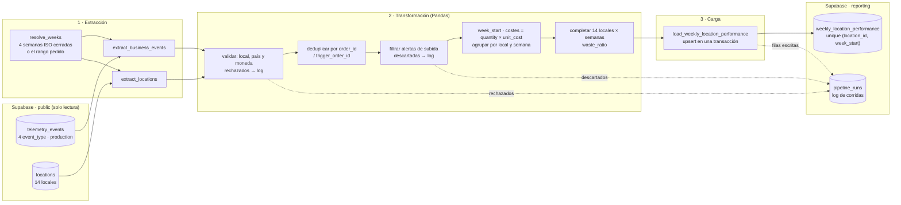

# Diseño del pipeline de desempeño de negocio — Brasaland

Documento de diseño del pipeline que produce el **"Reporte Semanal de Costo y Merma por Local"**. Es la Parte 1 de 3: aquí solo se diseña. La orquestación con Prefect se implementa en la Parte 2, y la Parte 3 divide las etapas en subflows, añade las pruebas y el dashboard.

- **Fecha:** 2026-11-23.
- **Fuentes:** briefing del pipeline de desempeño de negocio (secciones 1 a 7), briefing y plan de telemetría ([`docs/telemetry/telemetry-plan.md`](../../docs/telemetry/telemetry-plan.md), [`event-schemas.json`](../../docs/telemetry/event-schemas.json)) y el código actual del monorepo.
- **Fuera de alcance:** el reporte técnico de ingeniería (`services/telemetry/analysis.py` y `GET /telemetry/report`) no cambia. El pipeline **lee** `telemetry_events` y **nunca escribe** en ella.
- **Divergencias con el briefing:** en [`docs/BRIEFING_DIVERGENCES.md`](../../docs/BRIEFING_DIVERGENCES.md), sección "Pipeline de desempeño de negocio".

## Índice

1. [Propósito](#1-propósito)
2. [Estado actual](#2-estado-actual)
3. [Diseño del pipeline](#3-diseño-del-pipeline)
4. [Resiliencia e idempotencia](#4-resiliencia-e-idempotencia)
5. [Mapeo a Prefect](#5-mapeo-a-prefect)
6. [Integración con la aplicación](#6-integración-con-la-aplicación)
7. [Estructura del código](#7-estructura-del-código)
8. [Limitaciones de la v1 y fuera de alcance](#8-limitaciones-de-la-v1-y-fuera-de-alcance)
9. [Decisiones](#9-decisiones)

---

## 1. Propósito

> Producir cada lunes, antes de las 06:00 (hora de Bogotá), el **"Reporte Semanal de Costo y Merma por Local"** que leen Mariana (CEO) y Felipe (Director de Operaciones): una fila por cada uno de los 14 locales y cada semana ISO cerrada en `reporting.weekly_location_performance`, con los cinco KPIs del briefing (**costo de compra por local**, **costo de merma por local**, **ratio de merma**, **frecuencia de quiebre de stock** y **frecuencia de alertas de precio**), calculados sobre las métricas obligatorias `inbound_order_created`, `stock_waste_registered`, `stock_threshold_triggered` e `ingredient_price_variance_detected`.

| KPI del briefing | Columna | Evento de origen | Cálculo por local y semana |
|---|---|---|---|
| Costo de compra por local | `total_purchase_cost` | `inbound_order_created` | Σ `quantity × unit_cost` |
| Costo de merma por local | `total_waste_cost` | `stock_waste_registered` | Σ `quantity × unit_cost` (0 en las mermas sin `unit_cost`) |
| Ratio de merma | `waste_ratio` | Los dos anteriores | `total_waste_cost / total_purchase_cost`; 0 si no hubo compras |
| Frecuencia de quiebre de stock | `stockout_events_count` | `stock_threshold_triggered` | Número de eventos |
| Frecuencia de alertas de precio | `price_alert_events_count` | `ingredient_price_variance_detected` | Número de eventos con `variance_pct > 0` (subidas) |

Todo lo que sigue existe para calcular estos cinco números de forma correcta, repetible y auditable. Cada etapa se justifica por una de estas columnas; lo que no alimenta ninguna queda fuera de la v1 (§8).

---

## 2. Estado actual

### 2.1 Qué se captura

El backoffice emite 34 de los 44 eventos del plan de telemetría con una única función `track()`, al recibir la respuesta de la API que confirma o rechaza cada hecho (plan, §13). Los seis eventos **obligatorios** del briefing describen el inventario:

| Evento | Se emite cuando | Propiedades que usa este pipeline |
|---|---|---|
| `inbound_order_created` (1.0.0) | La API responde 201 a una entrada de proveedor | `order_id`, `location_id`, `country`, `currency`, `quantity`, `unit_cost` |
| `outbound_order_created` (1.0.0) | 201 a una salida por consumo | Ninguna (§8) |
| `stock_waste_registered` (1.1.0) | 201 a una salida por merma | `order_id`, `location_id`, `country`, `currency`, `quantity`, `unit_cost` (opcional) |
| `stock_threshold_triggered` (1.0.0) | Una salida hace cruzar el mínimo de stock | `trigger_order_id`, `location_id`, `country`, `currency` |
| `ingredient_price_variance_detected` (1.0.0) | El coste de una entrada se desvía más del 10 % de la media de 90 días | `order_id`, `location_id`, `country`, `currency`, `variance_pct` |
| `direct_stock_edit_rejected` (1.0.0) | La API rechaza un intento de editar el stock | Ninguna: no alimenta ningún KPI de este reporte |

Desde el diseño de este pipeline, los cinco eventos de órdenes toman `location_id`, `country` y `currency` del **local** de la orden (catálogo `locations`, brecha B7 cerrada), y la merma lleva su coste unitario (`stock_waste_registered` 1.1.0, plan de telemetría §17).

### 2.2 Dónde se almacena

- **`telemetry_events`** (Supabase, esquema `public`; migración `002_telemetry_events.sql`): ocho columnas (`id`, `timestamp`, `service`, `event_type`, `level`, `value`, `message`, `tags`). Las propiedades del evento y cinco campos del envelope (`session_id`, `user_id`, `request_id`, `schema_version`, `environment`) van en `tags` (`jsonb`). Índices por `timestamp`, por `event_type` y GIN sobre `tags`.
- **Inmutable:** solo admite `INSERT` (un trigger rechaza `UPDATE`, `DELETE` y `TRUNCATE`), con RLS activado y sin políticas. El receptor descarta los duplicados por `eventId` (`ON CONFLICT (id) DO NOTHING`).
- **`locations`** (migración `004_locations.sql`): los 14 locales (`id` 1–14, `code`, `name`, `city`, `country`, `currency`). 1–9 en Colombia (COP), de `medellin_centro` a `barranquilla_norte`; 10–14 en Florida (USD), de `miami_doral` a `fort_lauderdale`.

**Volumen a 2026-11-20:** 2 eventos de negocio en `telemetry_events`, ambos de `environment = development`. Las tablas del inventario tienen 7836 entradas y 13322 salidas (casi todas de semillas `VOL-`) que nunca emitieron eventos: la telemetría empezó a capturarse el 2026-11-19.

### 2.3 Qué responde ya el reporte técnico

`GET /telemetry/report` (solo `admin`, sobre `services/telemetry/analysis.py`) responde a ingeniería con cuatro métricas **por día UTC**: eventos por día y nivel, tasa de error por tipo de evento, latencia de la API por ruta y tasa de fallos de login. La vista `/telemetria` del backoffice las muestra.

### 2.4 La brecha

El reporte técnico cuenta **eventos**, pero el negocio necesita **dinero y frecuencias por local**. Hoy nadie puede responder a la pregunta de Mariana: *"¿qué local gastó más en compras la semana pasada, cuánto perdió por merma y cuál es el peor en proporción a lo que compra?"*. Le faltan cuatro cosas:

| Falta en el reporte técnico | Lo aporta este pipeline |
|---|---|
| Importes: no multiplica cantidades por costes ni conoce monedas | `quantity × unit_cost` por evento, sumado en la moneda del local y sin mezclar monedas |
| La dimensión local: agrupa por día y tipo de evento, nunca por `location_id` | Una fila por local con su `country` y su `currency`, cruzadas con `locations` |
| El grano semanal y las semanas sin actividad | Semanas ISO cerradas, con los 14 locales siempre presentes (ceros incluidos) |
| Un resultado estable: calcula en cada petición, con cache de 60 s | Una tabla persistida en el esquema `reporting`, recalculada por corridas registradas y auditables |

---

## 3. Diseño del pipeline

### 3.1 Formato de extracción

**Fuentes (solo lectura):**

| Fuente | Qué se lee | Formato | Actualización |
|---|---|---|---|
| `public.telemetry_events` | Los eventos de los 4 tipos que alimentan KPIs, en el rango de semanas de la corrida | Filas con `id` (uuid), `timestamp` (timestamptz) y `tags` (jsonb con las propiedades del evento) | Continua: el backoffice envía lotes cada 10 s o al llegar a 20 eventos, y con `sendBeacon` al ocultar la pestaña. Un evento puede llegar con retraso (reintentos, cola local), pero nunca cambia una vez guardado |
| `public.locations` | Las 14 filas | `id`, `code`, `name`, `country`, `currency` | Solo con una migración |

**Consulta de extracción** (una por corrida, apoyada en los índices de `timestamp` y `event_type`):

```sql
SELECT id, "timestamp", event_type, tags
FROM telemetry_events
WHERE event_type IN ('inbound_order_created', 'stock_waste_registered',
                     'stock_threshold_triggered', 'ingredient_price_variance_detected')
  AND "timestamp" >= :window_start   -- lunes 00:00 UTC de la primera semana
  AND "timestamp" <  :window_end     -- lunes 00:00 UTC siguiente a la última semana
  AND tags->>'environment' = :environment;
```

- **Entorno.** Solo se leen los eventos de `production` (riesgo R7 del plan de telemetría: los datos de prueba no entran en los indicadores). El entorno es configuración (bloque `weekly-location-performance-config`, §5.5): en desarrollo se apunta a `development` para verificar el pipeline.
- **Forma del payload** (`tags` de un `stock_waste_registered` 1.1.0):

```json
{
  "order_id": 13319, "location_id": 3, "country": "CO", "product_id": 12,
  "product_category": "proteína", "quantity": 1.2, "unit": "kg", "currency": "COP",
  "reason": "expired", "unit_cost": 38350, "stock_after": 30.4,
  "session_id": "0f8e7d6c-…", "user_id": "d445afb4-…", "request_id": "a1b2c3d4-…",
  "schema_version": "1.1.0", "environment": "production"
}
```

`location_id` es el entero 1–14 del inventario; la fila de destino usa el `code` del local (`medellin_envigado`), que sale del cruce con `locations`.

### 3.2 Flujo de datos



### 3.3 Reglas de la transformación

Funciones puras de Pandas (`data/process/`), sin bucles y sin acceso a la base, en este orden:

1. **Refinar.** Expandir `tags` a columnas (`location_id`, `country`, `currency`, `quantity`, `unit_cost`, `order_id`, `trigger_order_id`, `variance_pct`, `schema_version`). `timestamp` se convierte con `pd.to_datetime(..., utc=True)`.
2. **Validar contra `locations`.** Se rechaza el evento cuyo `location_id` no está en el catálogo (`unknown_location`), cuyo `country` o `currency` no son los del local (`country_mismatch`, `currency_mismatch`), o al que le falta un número imprescindible (`invalid_payload`: `quantity` o `unit_cost` de una entrada, `variance_pct` de una alerta). Los rechazados no se cuentan en ningún KPI; su número por motivo queda en el log de la corrida.
3. **Deduplicar el hecho de negocio.** El almacenamiento ya descarta los `eventId` repetidos; aquí se descarta además un segundo evento del **mismo hecho** con otro `eventId`. La clave es `(event_type, order_id)`, o `trigger_order_id` en los quiebres, y se conserva el de `timestamp` más antiguo. Motivo en el log: `duplicate_fact`.
4. **Alertas de precio.** Solo cuentan las subidas (`variance_pct > 0`); las bajadas se descartan con el motivo `price_decrease`.
5. **Semana.** `week_start` = el lunes de la semana ISO del `timestamp`, en UTC: `(ts.dt.normalize() - pd.to_timedelta(ts.dt.day_of_week, unit="D")).dt.date`, sobre la columna ya convertida a UTC.
6. **Importes.** `cost = quantity × unit_cost` en entradas y mermas. Una merma sin `unit_cost` (versión 1.0.0, o sin entradas previas del producto) cuenta con coste 0 y suma en `waste_events_without_cost` del log: el KPI queda por debajo del real y la corrida lo dice.
7. **Agregar.** `groupby(["location_id", "week_start"])` con `sum` de los importes y `count` de quiebres y alertas.
8. **Completar.** Producto cruzado de los 14 locales por las semanas de la corrida, con ceros donde no hubo actividad: Mariana ve los 14 locales todas las semanas, y una semana sin eventos se distingue de una semana sin calcular.
9. **Ratio.** `waste_ratio = total_waste_cost / total_purchase_cost`, redondeado a 4 decimales; 0 si `total_purchase_cost = 0`. Puede superar 1: un local puede perder en una semana producto comprado en semanas anteriores.
10. **Dimensiones finales.** `location_id` = `locations.code`, y `country` y `currency` del local. Los importes se redondean a 2 decimales en la moneda del local, **sin convertir** COP y USD.

### 3.4 Registros que cambian y duplicados

`telemetry_events` nunca actualiza una fila: es inmutable por diseño (§2.2). Para el pipeline, "un registro que cambia" es **una semana cuyo resultado cambia** después de calculada. Ocurre en tres casos, y los tres los resuelve el mismo mecanismo:

| Caso | Ejemplo | Mecanismo |
|---|---|---|
| Evento tardío de una semana ya calculada | Una pestaña sin conexión envía el lunes una merma del domingo | Cada corrida **recalcula enteras** las 4 últimas semanas cerradas y hace **upsert por `(location_id, week_start)`**: la fila se reescribe con el total correcto, nunca se le suma un delta |
| Evento repetido con otro `eventId` | Un mismo hecho emitido dos veces | Deduplicación por `order_id` o `trigger_order_id` en la transformación (§3.3, paso 3) |
| Reproceso de semanas antiguas | Un local reporta un error de hace dos meses, o cambia una regla del cálculo | `POST /reporting/pipeline-runs` con un rango de `week_start` (backfill): misma lógica y mismo upsert |

El upsert se apoya en el `unique (location_id, week_start)` del briefing:

```sql
INSERT INTO reporting.weekly_location_performance
    (location_id, country, week_start, total_purchase_cost, total_waste_cost, waste_ratio,
     stockout_events_count, price_alert_events_count, currency, computed_at)
VALUES (...), (...)
ON CONFLICT (location_id, week_start) DO UPDATE SET
    country = EXCLUDED.country,
    total_purchase_cost = EXCLUDED.total_purchase_cost,
    total_waste_cost = EXCLUDED.total_waste_cost,
    waste_ratio = EXCLUDED.waste_ratio,
    stockout_events_count = EXCLUDED.stockout_events_count,
    price_alert_events_count = EXCLUDED.price_alert_events_count,
    currency = EXCLUDED.currency,
    computed_at = now();
```

**Por qué 4 semanas.** La tabla no guarda la hora de recepción de cada evento (riesgo R4 del plan de telemetría), así que no hay una marca de agua fiable para leer "solo lo nuevo". Recalcular una ventana fija es más simple y siempre correcto. Con el volumen actual (cientos de eventos por semana), leer 4 semanas cuesta milisegundos. Un evento que llegue con más de 4 semanas de retraso, cosa que la cola del navegador no permite, se recupera con un backfill. La semana en curso nunca se calcula: estaría incompleta.

### 3.5 Tablas de destino (esquema `reporting`)

Las crea una migración nueva, `services/brasaland-api/migrations/005_reporting.sql`: idempotente, con RLS sin políticas como la 002 y la 004, y ejecutada a mano en Supabase. El pipeline nunca crea tablas.

**`reporting.weekly_location_performance`**: exactamente la del briefing (§5).

```sql
create table reporting.weekly_location_performance (
  id uuid primary key default gen_random_uuid(),
  location_id text not null,
  country text not null,
  week_start date not null,
  total_purchase_cost numeric not null default 0,
  total_waste_cost numeric not null default 0,
  waste_ratio numeric not null default 0,
  stockout_events_count integer not null default 0,
  price_alert_events_count integer not null default 0,
  currency text not null,
  computed_at timestamptz not null default now(),
  unique (location_id, week_start)
);
```

**`reporting.pipeline_runs`**: el log de corridas (§4.4).

**Permisos.** El pipeline se conecta con un rol propio, `reporting_pipeline`, y no con `postgres`. Tiene `SELECT` sobre `telemetry_events` y `locations` (con una política de RLS de solo lectura para ese rol), y `SELECT`, `INSERT` y `UPDATE` sobre `reporting.*`. Así, "solo lectura sobre `telemetry_events`" lo garantiza la base, no solo el código. La migración 005 concede los permisos; el rol y su contraseña los crea el desarrollador en Supabase, y la contraseña vive en un bloque de Prefect (§5.5), nunca en el repositorio.

### 3.6 Endpoints nuevos

Tres rutas en el módulo nuevo `services/reporting/`, fuera de `/api/v1` como las de telemetría, y separadas de `telemetry_events` y de `GET /telemetry/report`: `GET /reporting/weekly-location-performance` (KPIs), `GET /reporting/pipeline-runs/latest` (estado) y `POST /reporting/pipeline-runs` (disparo manual). El detalle está en la §6.

---

## 4. Resiliencia e idempotencia

### 4.1 Idempotencia

**Garantía:** correr el pipeline dos veces sobre el mismo rango de semanas deja `reporting.weekly_location_performance` exactamente igual (salvo `computed_at`). Se apoya en tres propiedades:

1. **Fuente inmutable.** `telemetry_events` no cambia entre corridas, salvo por eventos nuevos, que la segunda corrida debe incluir.
2. **Recalcular, nunca acumular.** Cada fila se calcula desde cero con todos los eventos de su semana; el upsert **sustituye** valores, nunca suma sobre lo que había.
3. **Carga atómica.** Todas las filas de la corrida (14 locales × N semanas) se escriben en **una sola transacción** con un único `INSERT … ON CONFLICT DO UPDATE`.

**Qué pasa si la carga falla y se vuelve a correr.** Ejemplo: la corrida del lunes 2026-11-30 calcula las semanas del 2 al 23 de noviembre (56 filas) y la conexión con Supabase se cae en mitad del `INSERT`.

| Momento | Estado de `weekly_location_performance` | Estado de `pipeline_runs` |
|---|---|---|
| Antes de la corrida | Las filas de la corrida anterior | — |
| Falla la carga | **Sin cambios:** PostgreSQL deshace la transacción entera, y no queda ninguna de las 56 filas a medias ni con una mezcla de valores viejos y nuevos | La corrida queda en `failed`, con `failed_task = load_weekly_location_performance` y el error |
| Reintento automático de la task (hasta 2, §5.2) | Si la base vuelve: se escriben las 56 filas; las que ya existían se reescriben | `completed`, con `rows_written = 56` |
| Segunda corrida manual (si los reintentos se agotan) | Recalcula desde la fuente las mismas 56 filas; el upsert escribe sobre las que ya hubiera | Una fila nueva en `completed`; la fallida se conserva como rastro |

En ningún caso se duplica una fila: el `unique (location_id, week_start)` lo impide en la base, y el upsert convierte el conflicto en una actualización.

### 4.2 Recuperabilidad

- **Dónde retomar.** Una corrida no guarda estado intermedio: su unidad de trabajo es el rango de semanas, que queda en el log (`week_from`, `week_to`). Retomar es volver a correr ese rango. Una corrida programada que falla se recupera sola la semana siguiente, porque su ventana de 4 semanas incluye las de la fallida; si no se quiere esperar, un administrador lanza `POST /reporting/pipeline-runs` con ese mismo rango.
- **Fallos transitorios.** Las tasks que hablan con la base (extracción y carga) se reintentan con espera creciente (§5.2). La transformación es determinista: reintentarla daría el mismo error, así que falla directamente.
- **Fallos que no son de la base** (una regla de la transformación con un bug, un evento con un formato inesperado): la corrida queda en `failed` con la task y el error, la tabla conserva los valores de la corrida anterior, y el endpoint de KPIs sigue sirviendo la última semana calculada.

### 4.3 Concurrencia

Dos corridas a la vez sobre las mismas semanas producirían el mismo resultado, pero ensuciarían el log y gastarían conexiones. Se evita en dos niveles:

- **Prefect:** el deployment tiene un límite de concurrencia de 1.
- **Base:** un índice único parcial en `reporting.pipeline_runs (pipeline) WHERE status IN ('pending', 'running')` impide registrar una segunda corrida activa del mismo pipeline. `POST /reporting/pipeline-runs` responde 409 si ya hay una.

Una corrida que muere sin cerrar su registro (el proceso del worker se cae) queda en `running`. El flow tiene un tiempo máximo de 30 minutos, y al abrir una corrida nueva se marcan como `failed` (`error_message = 'abandoned'`) las que siguen activas más allá de ese tiempo.

### 4.4 Log de ejecución: `reporting.pipeline_runs`

Una fila por corrida, creada al dispararla y cerrada al terminar, con éxito o sin él. Es la respuesta de `GET /reporting/pipeline-runs/latest`. La columna `pipeline` permite reutilizar la tabla con futuros pipelines.

| Campo | Tipo | Justificación para la auditoría |
|---|---|---|
| `id` | `uuid` PK | Identifica la corrida; `POST` lo devuelve para seguirla |
| `pipeline` | `text` NOT NULL | Qué pipeline corrió (`weekly_location_performance`); el mismo log sirve a los siguientes |
| `prefect_flow_run_id` | `uuid` NULL | Enlaza con la corrida en Prefect, donde están los logs y los estados de cada task |
| `trigger` | `text` NOT NULL (`scheduled`, `manual`) | Distingue la corrida del lunes de un reproceso pedido por una persona |
| `requested_by` | `uuid` NULL | Quién pidió la corrida manual (el `sub` del token del administrador) |
| `week_from`, `week_to` | `date` NOT NULL | Qué semanas recalculó: es lo que hay que volver a correr si falla |
| `status` | `text` NOT NULL (`pending`, `running`, `completed`, `failed`) | Si se puede confiar en las semanas del rango |
| `created_at` | `timestamptz` NOT NULL | Cuándo se pidió; con `started_at`, mide la espera en la cola de Prefect |
| `started_at` | `timestamptz` NULL | Hora de inicio real |
| `finished_at` | `timestamptz` NULL | Hora de fin; con `started_at`, la duración. NULL mientras corre |
| `events_read` | `integer` NOT NULL | Cuántos eventos entraron: un 0 en un lunes normal delata un problema en la captura |
| `events_rejected` | `integer` NOT NULL | Cuántos se excluyeron por datos inválidos |
| `events_discarded` | `integer` NOT NULL | Cuántos se excluyeron por regla (duplicados, alertas de bajada) |
| `waste_events_without_cost` | `integer` NOT NULL | Mermas que contaron con coste 0: cuánto subestima la corrida el coste de merma |
| `issues` | `jsonb` NOT NULL | Conteo por motivo (`unknown_location`, `country_mismatch`, `currency_mismatch`, `invalid_payload`, `duplicate_fact`, `price_decrease`); nunca valores del payload |
| `rows_written` | `integer` NOT NULL | Filas escritas por el upsert (14 × semanas en una corrida completa) |
| `failed_task` | `text` NULL | En qué etapa falló: extracción, transformación o carga |
| `error_message` | `text` NULL | El error resumido (tipo y mensaje, sin cadenas de conexión) |

Restricciones: `CHECK (week_from <= week_to)`, `CHECK` de los valores de `trigger` y `status`, y el índice único parcial de la §4.3. Los conteos cumplen `events_read = válidos + events_rejected + events_discarded`, lo que permite cuadrar cada corrida.

---

## 5. Mapeo a Prefect

### 5.1 Flow principal

`weekly_location_performance_flow(week_from: date | None = None, week_to: date | None = None, trigger: str = "scheduled", run_id: UUID | None = None)`

- Sin rango, calcula las 4 últimas semanas ISO cerradas; con rango, hace un backfill. El mismo flow sirve para los dos casos, así que la v1 no necesita un segundo flow.
- `run_id` llega cuando lo dispara la API, que ya registró la corrida en `pending` (§6.3). En las corridas programadas, el flow la crea.
- `timeout_seconds=1800` y `log_prints=False`: el flow registra con `get_run_logger()`.

### 5.2 Tasks

| Task | Etapa | Entrada → salida | Reintentos |
|---|---|---|---|
| `open_pipeline_run` | Control | Parámetros → `run_id` en `running`; cierra las corridas abandonadas | 2, cada 10 s |
| `resolve_weeks` | Extracción | `week_from`, `week_to` y la fecha actual → lista de lunes; rechaza la semana en curso | No |
| `extract_business_events` | Extracción | Rango UTC y entorno → `DataFrame` de `telemetry_events` (§3.1) | 3, con espera de 10, 30 y 90 s |
| `extract_locations` | Extracción | — → `DataFrame` de las 14 filas de `locations` | 3, con espera de 10, 30 y 90 s |
| `transform_weekly_location_performance` | Transformación | Eventos, locales y semanas → filas de destino y conteos para el log (§3.3) | No: es determinista |
| `load_weekly_location_performance` | Carga | Filas → `rows_written`, con upsert en una transacción (§3.4) | 2, con espera de 30 y 120 s |
| `close_pipeline_run` | Control | `run_id`, conteos → la corrida en `completed` | 2, cada 10 s |

La transformación llama a las funciones puras de `data/process/`: la task solo las orquesta. Las tasks de extracción usan `task_run_name` con el rango de semanas, para leerlas en la interfaz de Prefect.

### 5.3 States

| State | Dónde se ve | Qué significa aquí |
|---|---|---|
| `Scheduled` | Flow | La corrida del lunes espera su hora, o la manual espera a un worker |
| `Pending` | Flow y tasks | Un worker la tomó; la corrida sigue en `pending` en el log |
| `Running` | Flow y tasks | En curso; el log pasa a `running` en `open_pipeline_run` |
| `Retrying` / `AwaitingRetry` | Tasks de extracción y carga | Fallo transitorio de la base; vuelve a intentar con espera |
| `Completed` | Flow y tasks | Todas las filas escritas; el log pasa a `completed` |
| `Failed` | Flow y tasks | Una task agotó sus reintentos o la transformación falló. El hook `on_failure` del flow pone la corrida en `failed` con `failed_task` y `error_message` |
| `Crashed` | Flow | El proceso murió (sin memoria, worker detenido). El hook `on_crashed` cierra la corrida igual que `on_failure`; si ni el hook llega a correr, la siguiente corrida la marca como `abandoned` (§4.3) |
| `Cancelled` | Flow | Cancelada desde Prefect: el hook `on_cancellation` la deja en `failed` con `error_message = 'cancelled'` |

### 5.4 Deployment

- **Nombre:** `weekly-location-performance/weekly`.
- **Programación:** cron `0 6 * * 1`, zona `America/Bogota`, que son las 11:00 UTC. Las semanas cierran el lunes a las 00:00 UTC, así que la corrida de las 06:00 de Bogotá deja el reporte listo cuando Mariana lo abre.
- **Work pool:** `brasaland-process` (de tipo proceso), con un worker en el mismo `docker-compose` del monorepo en la Parte 2.
- **Concurrencia:** límite de 1 (§4.3).

### 5.5 Bloques de configuración

| Bloque | Tipo | Contenido | Por qué un bloque |
|---|---|---|---|
| `brasaland-reporting-db` | `Secret` | Cadena de conexión de Supabase con el rol `reporting_pipeline` | Es una credencial: no puede vivir en el código ni en el repositorio, y se rota sin redeplegar |
| `weekly-location-performance-config` | Bloque propio, `WeeklyLocationPerformanceConfig(Block)` | `environment` (`production`), `lookback_weeks` (4), `max_backfill_weeks` (26) y `stale_run_minutes` (30), con tipos y valores por defecto | Cambiar el entorno de lectura en desarrollo, o la ventana, sin tocar el código; un bloque con tipos valida la configuración al cargarla (el bloque genérico `JSON` está obsoleto en Prefect 3) |

La API no usa estos bloques: para disparar corridas solo necesita `PREFECT_API_URL` en su entorno (§6.3), y para leer `reporting.*` usa su propia conexión (`DATABASE_URL`).

---

## 6. Integración con la aplicación

`services/reporting/` es un paquete local (`brasaland-reporting`) con un `APIRouter`, sus esquemas de Pydantic y nada más. La API lo instala en modo editable y lo monta en `app/main.py`, como `services/telemetry/`. **No contiene lógica de ETL ni SQL:** autentica, valida los parámetros y serializa. Toda la lectura y la escritura de `reporting.*` vive en `data/pipelines/`, el paquete dueño de esas tablas. `services/` importa de `data/pipelines/`, nunca al revés.

| Endpoint | Rol | Importa de `data/pipelines/` |
|---|---|---|
| `GET /reporting/weekly-location-performance` | `admin`, `manager` | `brasaland_pipelines.weekly_location_performance.repository.read_weekly_location_performance` |
| `GET /reporting/pipeline-runs/latest` | `admin`, `manager` | `brasaland_pipelines.weekly_location_performance.repository.read_latest_pipeline_run` |
| `POST /reporting/pipeline-runs` | `admin` | `brasaland_pipelines.weekly_location_performance.trigger.trigger_pipeline_run` |

Los errores siguen el formato de la API (`{"error": {"code", "message"}}`): 401 sin token y 403 con otro rol.

### 6.1 Consulta de KPIs: `GET /reporting/weekly-location-performance`

- **Parámetro:** `week_start` opcional (`YYYY-MM-DD`, un lunes). Sin él, la semana calculada más reciente.
- **Función:** `read_weekly_location_performance(conn, week_start: date | None) -> WeeklyPerformance | None`, que lee `reporting.weekly_location_performance` cruzada con `locations` (para `location_name`), ordenada por país y por el `id` del local.
- **Respuesta 200:** la forma del briefing, más `location_name` en cada local:

```json
{
  "week_start": "2026-11-16",
  "locations": [
    {
      "location_id": "medellin_centro",
      "location_name": "Medellín Centro",
      "country": "CO",
      "total_purchase_cost": 8420000,
      "total_waste_cost": 610000,
      "waste_ratio": 0.0724,
      "stockout_events_count": 2,
      "price_alert_events_count": 1,
      "currency": "COP"
    }
  ]
}
```

- **Errores:** 422 `invalid_week_start` si la fecha no es un lunes; 404 `week_not_computed` si esa semana (o ninguna) está calculada; 503 `reporting_unavailable` si faltan las tablas de la migración 005.
- **Cache:** en memoria, 5 minutos por `week_start`, con `X-Cache: HIT` o `MISS`, como el resto de la API. Los datos cambian una vez por semana; tras una corrida manual, el resultado nuevo se ve en 5 minutos como mucho.

### 6.2 Estado: `GET /reporting/pipeline-runs/latest`

- **Función:** `read_latest_pipeline_run(conn, pipeline="weekly_location_performance") -> PipelineRun | None`: la última fila de `reporting.pipeline_runs` por `created_at`.
- **Respuesta 200:** los campos de la §4.4 (`id`, `trigger`, `week_from`, `week_to`, `status`, `created_at`, `started_at`, `finished_at`, conteos, `issues`, `rows_written`, `failed_task`, `error_message`). `requested_by` no se expone.
- **Errores:** 404 `no_pipeline_runs` si el pipeline nunca corrió. Sin cache: es lo que se consulta para seguir una corrida.

### 6.3 Disparo manual: `POST /reporting/pipeline-runs`

- **Cuerpo opcional:** `{"week_from": "2026-09-07", "week_to": "2026-11-16"}`. Sin cuerpo, las 4 últimas semanas cerradas.
- **Función:** `trigger_pipeline_run(conn, week_from, week_to, requested_by) -> PipelineRun`, que:
  1. valida el rango (lunes, `week_from ≤ week_to`, sin la semana en curso, 26 semanas como máximo);
  2. registra la corrida en `pending` (`trigger = manual`); el índice único parcial rechaza una segunda corrida activa;
  3. crea la corrida en Prefect con `run_deployment("weekly-location-performance/weekly", parameters={…, "run_id": …}, timeout=0)`, sin esperar a que termine, y guarda el `prefect_flow_run_id`.
- **Respuesta 202:** la corrida en `pending` (`id`, `week_from`, `week_to`, `status`). Se sigue con `GET /reporting/pipeline-runs/latest`.
- **Errores:** 422 `invalid_week_range`; 409 `pipeline_run_in_progress`; 503 `orchestrator_unavailable` si Prefect no responde (la corrida se marca `failed` con ese error).
- **La API nunca ejecuta el ETL:** lo pone en la cola de Prefect, y el worker lo corre fuera del proceso de la API.

---

## 7. Estructura del código

Para las Partes 2 y 3. Las transformaciones reutilizables van en `data/process/`; la orquestación y el acceso a `reporting.*`, en `data/pipelines/`; el HTTP, en `services/reporting/`.

```
data/
├── process/
│   └── weekly_location_performance.py   # funciones puras de Pandas (§3.3): refine, validate,
│                                        # dedupe, aggregate, fill_missing_weeks, waste_ratio
└── pipelines/
    ├── PIPELINE_DESIGN.md               # este documento
    ├── pyproject.toml                   # paquete local brasaland-pipelines (prefect, pandas, sqlalchemy)
    └── weekly_location_performance/
        ├── flows.py                     # weekly_location_performance_flow y sus hooks
        ├── tasks.py                     # las 7 tasks de la §5.2
        ├── repository.py                # SQL de reporting.*: upsert, log de corridas y lecturas de la API
        ├── trigger.py                   # trigger_pipeline_run (run_deployment)
        └── deployment.py                # weekly-location-performance/weekly (cron, work pool, límite)

services/
├── brasaland-api/migrations/005_reporting.sql   # esquema reporting, las dos tablas, permisos y RLS
└── reporting/                           # paquete local brasaland-reporting (solo HTTP)
    ├── router.py                        # las 3 rutas de la §6
    └── schemas.py                       # modelos de respuesta
```

En la Parte 3, la extracción, la transformación y la carga pasan de tasks a **subflows** del flow principal, cada uno con sus tasks y sus pruebas.

---

## 8. Limitaciones de la v1 y fuera de alcance

- **Quiebres de stock con el mínimo provisional (brecha B3).** `stock_threshold_triggered` se emite cuando el **stock global** del producto cruza el umbral de stock bajo de su unidad (40 kg, 25 litros o 100 unidades), no un mínimo por local. El conteo se asigna al local de la salida que provocó el cruce. Es la mejor señal disponible, y así lo indica el reporte. Los mínimos y el stock por local son requisito de la v2; al cerrarse B3, la versión del evento subirá para distinguir las semanas medidas con cada criterio.
- **Semana en UTC.** El briefing fija `week_start` en UTC. Un evento del domingo a partir de las 19:00 en Bogotá (20:00 en Miami en horario de verano) cae en la semana siguiente. La v2 puede calcular la semana en la zona horaria de cada local.
- **Eventos del navegador.** Los emite el backoffice (riesgo R3 del plan de telemetría): una orden registrada fuera del backoffice, o una pestaña que se cierra antes de enviar la cola, no deja evento. Los KPIs reflejan las órdenes con telemetría, no la tabla del inventario. El `timestamp` es el del navegador (R4).
- **Historia anterior a la captura.** Las órdenes del inventario anteriores al 2026-11-19 no tienen eventos, y el pipeline no las lee: mezclar dos fuentes del mismo hecho rompería la trazabilidad. Un backfill desde las tablas del inventario es una decisión aparte.
- **Mermas sin coste.** Las mermas 1.0.0 (y las de productos sin entradas con coste) cuentan con coste 0 y quedan contadas en el log (§3.3, paso 6).
- **Sin conversión de monedas** (briefing, §4): cada fila está en la moneda de su local, y COP y USD nunca se suman. La comparación entre países se hace con `waste_ratio`, que no tiene unidad.
- **`outbound_order_created` no se extrae.** El briefing lo da como contexto de volumen y no alimenta ningún KPI ni ninguna columna de la tabla de destino. Si la Parte 3 necesita detectar anomalías de volumen, se añade entonces.
- **Sin alertas automáticas.** Una corrida fallida queda en el log y en Prefect; notificar (correo o Slack con un bloque de Prefect) es una mejora posterior.

---

## 9. Decisiones

Tomadas con el desarrollador el 2026-11-20 (ajuste de P5 el 2026-11-23). Las divergencias con el briefing que generan están en `docs/BRIEFING_DIVERGENCES.md`.

| # | Decisión |
|---|---|
| P1 | `unit_cost` opcional en `stock_waste_registered` (1.1.0), calculado por el backoffice como coste medio ponderado de las entradas del producto. Sin él, la merma cuenta con coste 0 y se registra |
| P2 | `location_id` de la tabla es el `code` del local (`medellin_centro`, con guion bajo, como en el catálogo `locations`; el ejemplo del briefing usa guion). `country` y `currency` salen de `locations`. El endpoint de KPIs añade `location_name` |
| P3 | `price_alert_events_count` cuenta solo las subidas (`variance_pct > 0`) |
| P4 | `stockout_events_count` cuenta los `stock_threshold_triggered` tal como llegan, con la limitación de B3 documentada |
| P5 | `services/reporting/` como paquete local montado en la API, con las rutas del briefing fuera de `/api/v1`: lecturas para `admin` y `manager`, disparo solo `admin`. La lectura de `reporting.*` y el disparo viven en `data/pipelines/` |
| P6 | Prefect los lunes a las 06:00 America/Bogota; recalcula las 4 últimas semanas cerradas con upsert; backfill por rango; 14 filas por semana, también con ceros; log en `reporting.pipeline_runs` |
