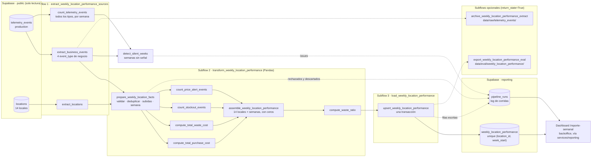

# Diseño del pipeline de desempeño de negocio — Brasaland

Documento de diseño del pipeline que produce el **"Reporte Semanal de Costo y Merma por Local"**. La Parte 1 de 3 lo diseñó; la Parte 2 lo implementó con Prefect (`data/pipelines/pipeline.py`), y la Parte 3 lo dividió en subflows, añadió los tests unitarios de las tasks de KPI (`tests/pipelines/test_pipeline.py`) y el dashboard del backoffice (`/reporte-semanal`). Las secciones 1 a 10 describen el pipeline tal como está; la §11 y la §12 recogen lo que cambió en cada parte respecto al diseño aprobado, y por qué.

- **Fecha:** 2026-11-23 (diseño, implementación y Parte 3).
- **Frecuencia y comando de ejecución:** §10.
- **Fuentes:** briefing del pipeline de desempeño de negocio (secciones 1 a 7), briefing y plan de telemetría ([`docs/telemetry/telemetry-plan.md`](../../docs/telemetry/telemetry-plan.md), [`event-schemas.json`](../../docs/telemetry/event-schemas.json)) y el código actual del monorepo.
- **Fuera de alcance:** el reporte técnico de ingeniería (`services/telemetry/analysis.py` y `GET /telemetry/report`) no cambia. El pipeline **lee** `telemetry_events` y **nunca escribe** en ella.
- **Divergencias con el briefing:** en [`docs/BRIEFING_DIVERGENCES.md`](../../docs/BRIEFING_DIVERGENCES.md), sección "Pipeline de desempeño de negocio".

## Índice

1. [Propósito](#1-propósito)
2. [Estado actual](#2-estado-actual)
3. [Diseño del pipeline](#3-diseño-del-pipeline)
4. [Resiliencia e idempotencia](#4-resiliencia-e-idempotencia)
5. [Mapeo a Prefect](#5-mapeo-a-prefect)
6. [Integración con la aplicación](#6-integración-con-la-aplicación)
7. [Estructura del código](#7-estructura-del-código)
8. [Limitaciones de la v1 y fuera de alcance](#8-limitaciones-de-la-v1-y-fuera-de-alcance)
9. [Decisiones](#9-decisiones)
10. [Ejecución: frecuencia y comandos](#10-ejecución-frecuencia-y-comandos)
11. [Implementación (Parte 2): ajustes al diseño y verificación](#11-implementación-parte-2-ajustes-al-diseño-y-verificación)
12. [Producción (Parte 3): subflows, tests, dashboard y señales de silencio](#12-producción-parte-3-subflows-tests-dashboard-y-señales-de-silencio)

---

## 1. Propósito

> Producir cada lunes, antes de las 06:00 (hora de Bogotá), el **"Reporte Semanal de Costo y Merma por Local"** que leen Mariana (CEO) y Felipe (Director de Operaciones): una fila por cada uno de los 14 locales y cada semana ISO cerrada en `reporting.weekly_location_performance`, con los cinco KPIs del briefing (**costo de compra por local**, **costo de merma por local**, **ratio de merma**, **frecuencia de quiebre de stock** y **frecuencia de alertas de precio**), calculados sobre las métricas obligatorias `inbound_order_created`, `stock_waste_registered`, `stock_threshold_triggered` e `ingredient_price_variance_detected`.

| KPI del briefing | Columna | Evento de origen | Cálculo por local y semana |
|---|---|---|---|
| Costo de compra por local | `total_purchase_cost` | `inbound_order_created` | Σ `quantity × unit_cost` |
| Costo de merma por local | `total_waste_cost` | `stock_waste_registered` | Σ `quantity × unit_cost` (0 en las mermas sin `unit_cost`) |
| Ratio de merma | `waste_ratio` | Los dos anteriores | `total_waste_cost / total_purchase_cost`; 0 si no hubo compras |
| Frecuencia de quiebre de stock | `stockout_events_count` | `stock_threshold_triggered` | Número de eventos |
| Frecuencia de alertas de precio | `price_alert_events_count` | `ingredient_price_variance_detected` | Número de eventos con `variance_pct > 0` (subidas) |

Todo lo que sigue existe para calcular estos cinco números de forma correcta, repetible y auditable. Cada etapa se justifica por una de estas columnas; lo que no alimenta ninguna queda fuera de la v1 (§8).

---

## 2. Estado actual

### 2.1 Qué se captura

El backoffice emite 34 de los 44 eventos del plan de telemetría con una única función `track()`, al recibir la respuesta de la API que confirma o rechaza cada hecho (plan, §13). Los seis eventos **obligatorios** del briefing describen el inventario:

| Evento | Se emite cuando | Propiedades que usa este pipeline |
|---|---|---|
| `inbound_order_created` (1.0.0) | La API responde 201 a una entrada de proveedor | `order_id`, `location_id`, `country`, `currency`, `quantity`, `unit_cost` |
| `outbound_order_created` (1.0.0) | 201 a una salida por consumo | Ninguna (§8) |
| `stock_waste_registered` (1.1.0) | 201 a una salida por merma | `order_id`, `location_id`, `country`, `currency`, `quantity`, `unit_cost` (opcional) |
| `stock_threshold_triggered` (1.0.0) | Una salida hace cruzar el mínimo de stock | `trigger_order_id`, `location_id`, `country`, `currency` |
| `ingredient_price_variance_detected` (1.0.0) | El coste de una entrada se desvía más del 10 % de la media de 90 días | `order_id`, `location_id`, `country`, `currency`, `variance_pct` |
| `direct_stock_edit_rejected` (1.0.0) | La API rechaza un intento de editar el stock | Ninguna: no alimenta ningún KPI de este reporte |

Desde el diseño de este pipeline, los cinco eventos de órdenes toman `location_id`, `country` y `currency` del **local** de la orden (catálogo `locations`, brecha B7 cerrada), y la merma lleva su coste unitario (`stock_waste_registered` 1.1.0, plan de telemetría §17).

### 2.2 Dónde se almacena

- **`telemetry_events`** (Supabase, esquema `public`; migración `002_telemetry_events.sql`): ocho columnas (`id`, `timestamp`, `service`, `event_type`, `level`, `value`, `message`, `tags`). Las propiedades del evento y cinco campos del envelope (`session_id`, `user_id`, `request_id`, `schema_version`, `environment`) van en `tags` (`jsonb`). Índices por `timestamp`, por `event_type` y GIN sobre `tags`.
- **Inmutable:** solo admite `INSERT` (un trigger rechaza `UPDATE`, `DELETE` y `TRUNCATE`), con RLS activado y sin políticas. El receptor descarta los duplicados por `eventId` (`ON CONFLICT (id) DO NOTHING`).
- **`locations`** (migración `004_locations.sql`): los 14 locales (`id` 1–14, `code`, `name`, `city`, `country`, `currency`). 1–9 en Colombia (COP), de `medellin_centro` a `barranquilla_norte`; 10–14 en Florida (USD), de `miami_doral` a `fort_lauderdale`.

**Volumen a 2026-11-20:** 2 eventos de negocio en `telemetry_events`, ambos de `environment = development`. Las tablas del inventario tienen 7836 entradas y 13322 salidas (casi todas de semillas `VOL-`) que nunca emitieron eventos: la telemetría empezó a capturarse el 2026-11-19.

### 2.3 Qué responde ya el reporte técnico

`GET /telemetry/report` (solo `admin`, sobre `services/telemetry/analysis.py`) responde a ingeniería con cuatro métricas **por día UTC**: eventos por día y nivel, tasa de error por tipo de evento, latencia de la API por ruta y tasa de fallos de login. La vista `/telemetria` del backoffice las muestra.

### 2.4 La brecha

El reporte técnico cuenta **eventos**, pero el negocio necesita **dinero y frecuencias por local**. Hoy nadie puede responder a la pregunta de Mariana: *"¿qué local gastó más en compras la semana pasada, cuánto perdió por merma y cuál es el peor en proporción a lo que compra?"*. Le faltan cuatro cosas:

| Falta en el reporte técnico | Lo aporta este pipeline |
|---|---|
| Importes: no multiplica cantidades por costes ni conoce monedas | `quantity × unit_cost` por evento, sumado en la moneda del local y sin mezclar monedas |
| La dimensión local: agrupa por día y tipo de evento, nunca por `location_id` | Una fila por local con su `country` y su `currency`, cruzadas con `locations` |
| El grano semanal y las semanas sin actividad | Semanas ISO cerradas, con los 14 locales siempre presentes (ceros incluidos) |
| Un resultado estable: calcula en cada petición, con cache de 60 s | Una tabla persistida en el esquema `reporting`, recalculada por corridas registradas y auditables |

---

## 3. Diseño del pipeline

### 3.1 Formato de extracción

**Fuentes (solo lectura):**

| Fuente | Qué se lee | Formato | Actualización |
|---|---|---|---|
| `public.telemetry_events` | Los eventos de los 4 tipos que alimentan KPIs, en el rango de semanas de la corrida | Filas con `id` (uuid), `timestamp` (timestamptz) y `tags` (jsonb con las propiedades del evento) | Continua: el backoffice envía lotes cada 10 s o al llegar a 20 eventos, y con `sendBeacon` al ocultar la pestaña. Un evento puede llegar con retraso (reintentos, cola local), pero nunca cambia una vez guardado |
| `public.locations` | Las 14 filas | `id`, `code`, `name`, `country`, `currency` | Solo con una migración |

**Consulta de extracción** (una por corrida, apoyada en los índices de `timestamp` y `event_type`):

```sql
SELECT id, "timestamp", event_type, tags
FROM telemetry_events
WHERE event_type IN ('inbound_order_created', 'stock_waste_registered',
                     'stock_threshold_triggered', 'ingredient_price_variance_detected')
  AND "timestamp" >= :window_start   -- lunes 00:00 UTC de la primera semana
  AND "timestamp" <  :window_end     -- lunes 00:00 UTC siguiente a la última semana
  AND tags->>'environment' = :environment
ORDER BY "timestamp", id;
```

- **Entorno.** Solo se leen los eventos de `production` (riesgo R7 del plan de telemetría: los datos de prueba no entran en los indicadores). El entorno es configuración (bloque `weekly-location-performance-config`, §5.5): en desarrollo se apunta a `development` para verificar el pipeline.
- **Forma del payload** (`tags` de un `stock_waste_registered` 1.1.0):

```json
{
  "order_id": 13319, "location_id": 3, "country": "CO", "product_id": 12,
  "product_category": "proteína", "quantity": 1.2, "unit": "kg", "currency": "COP",
  "reason": "expired", "unit_cost": 38350, "stock_after": 30.4,
  "session_id": "0f8e7d6c-…", "user_id": "d445afb4-…", "request_id": "a1b2c3d4-…",
  "schema_version": "1.1.0", "environment": "production"
}
```

`location_id` es el entero 1–14 del inventario; la fila de destino usa el `code` del local (`medellin_envigado`), que sale del cruce con `locations`.

### 3.2 Flujo de datos

El flow principal, `weekly_location_performance_flow`, resuelve las semanas (`resolve_weeks`), abre la corrida en el log y llama a los subflows en este orden; al final cierra la corrida (§5).



### 3.3 Reglas de la transformación

Funciones puras de Pandas (`data/process/weekly_location_performance.py`), sin bucles y sin acceso a la base, en este orden. En el subflow de transformación, cada grupo de pasos es una task: los pasos 1 a 5 son `prepare_weekly_location_facts`; los 6 y 7, una task por KPI (`compute_total_purchase_cost`, `compute_total_waste_cost`, `count_stockout_events`, `count_price_alert_events`); los 8 y 10, `assemble_weekly_location_performance`; el 9, `compute_waste_ratio`.

1. **Refinar.** Expandir `tags` a columnas (`location_id`, `country`, `currency`, `quantity`, `unit_cost`, `order_id`, `trigger_order_id`, `variance_pct`, `schema_version`). `timestamp` se convierte con `pd.to_datetime(..., utc=True)`.
2. **Validar contra `locations`.** Se rechaza el evento cuyo `location_id` no está en el catálogo (`unknown_location`), cuyo `country` o `currency` no son los del local (`country_mismatch`, `currency_mismatch`), o al que le falta un número imprescindible (`invalid_payload`: `quantity` o `unit_cost` de una entrada, `variance_pct` de una alerta). Los rechazados no se cuentan en ningún KPI; su número por motivo queda en el log de la corrida.
3. **Deduplicar el hecho de negocio.** El almacenamiento ya descarta los `eventId` repetidos; aquí se descarta además un segundo evento del **mismo hecho** con otro `eventId`. La clave es `(event_type, order_id)`, o `trigger_order_id` en los quiebres, y se conserva el de `timestamp` más antiguo. Motivo en el log: `duplicate_fact`.
4. **Alertas de precio.** Solo cuentan las subidas (`variance_pct > 0`); las bajadas se descartan con el motivo `price_decrease`.
5. **Semana.** `week_start` = el lunes de la semana ISO del `timestamp`, en UTC: `(ts.dt.normalize() - pd.to_timedelta(ts.dt.day_of_week, unit="D")).dt.date`, sobre la columna ya convertida a UTC. Un hecho cuya semana no está entre las de la corrida se descarta con el motivo `outside_window` (salvaguarda: la consulta ya filtra por la ventana).
6. **Importes.** `cost = quantity × unit_cost` en entradas y mermas. Una merma sin `unit_cost` (versión 1.0.0, o sin entradas previas del producto) cuenta con coste 0 y suma en `waste_events_without_cost` del log: el KPI queda por debajo del real y la corrida lo dice.
7. **Agregar, un KPI cada vez.** `groupby(["location_id", "week_start"])` con `sum` de los importes de compra y de merma y `count` de quiebres y de alertas, en una función por KPI con el nombre de su columna.
8. **Completar.** Producto cruzado de los 14 locales por las semanas de la corrida, con ceros donde no hubo actividad: Mariana ve los 14 locales todas las semanas, y una semana sin eventos se distingue de una semana sin calcular.
9. **Ratio.** `waste_ratio = total_waste_cost / total_purchase_cost` de cada fila, sobre los totales ya redondeados (la definición del briefing), redondeado a 4 decimales; 0 si `total_purchase_cost = 0`. Puede superar 1: un local puede perder en una semana producto comprado en semanas anteriores.
10. **Dimensiones finales.** `location_id` = `locations.code`, y `country` y `currency` del local. Los importes se redondean a 2 decimales en la moneda del local, **sin convertir** COP y USD.

**Entradas inválidas.** Un evento mal formado (un número que no lo es, un dato imprescindible nulo, `tags` vacío) se rechaza en el paso 2 y queda en el log: no rompe la corrida. Las funciones de los KPIs fallan con `ValueError` si les llega un hecho que la preparación debía haber rechazado (una entrada sin coste, una alerta de bajada, un coste negativo): un KPI mal contado en silencio es peor que una corrida fallida, que queda en el log con la task y el error.

### 3.4 Registros que cambian y duplicados

`telemetry_events` nunca actualiza una fila: es inmutable por diseño (§2.2). Para el pipeline, "un registro que cambia" es **una semana cuyo resultado cambia** después de calculada. Ocurre en tres casos, y los tres los resuelve el mismo mecanismo:

| Caso | Ejemplo | Mecanismo |
|---|---|---|
| Evento tardío de una semana ya calculada | Una pestaña sin conexión envía el lunes una merma del domingo | Cada corrida **recalcula enteras** las 4 últimas semanas cerradas y hace **upsert por `(location_id, week_start)`**: la fila se reescribe con el total correcto, nunca se le suma un delta |
| Evento repetido con otro `eventId` | Un mismo hecho emitido dos veces | Deduplicación por `order_id` o `trigger_order_id` en la transformación (§3.3, paso 3) |
| Reproceso de semanas antiguas | Un local reporta un error de hace dos meses, o cambia una regla del cálculo | `POST /reporting/pipeline-runs` con un rango de `week_start` (backfill): misma lógica y mismo upsert |

El upsert se apoya en el `unique (location_id, week_start)` del briefing:

```sql
INSERT INTO reporting.weekly_location_performance
    (location_id, country, week_start, total_purchase_cost, total_waste_cost, waste_ratio,
     stockout_events_count, price_alert_events_count, currency, computed_at)
VALUES (...), (...)
ON CONFLICT (location_id, week_start) DO UPDATE SET
    country = EXCLUDED.country,
    total_purchase_cost = EXCLUDED.total_purchase_cost,
    total_waste_cost = EXCLUDED.total_waste_cost,
    waste_ratio = EXCLUDED.waste_ratio,
    stockout_events_count = EXCLUDED.stockout_events_count,
    price_alert_events_count = EXCLUDED.price_alert_events_count,
    currency = EXCLUDED.currency,
    computed_at = now();
```

**Por qué 4 semanas.** La tabla no guarda la hora de recepción de cada evento (riesgo R4 del plan de telemetría), así que no hay una marca de agua fiable para leer "solo lo nuevo". Recalcular una ventana fija es más simple y siempre correcto. Con el volumen actual (cientos de eventos por semana), leer 4 semanas cuesta milisegundos. Un evento que llegue con más de 4 semanas de retraso, cosa que la cola del navegador no permite, se recupera con un backfill. La semana en curso nunca se calcula: estaría incompleta.

### 3.5 Tablas de destino (esquema `reporting`)

Las crea una migración nueva, `services/brasaland-api/migrations/005_reporting.sql`: idempotente, con RLS sin políticas como la 002 y la 004, y ejecutada a mano en Supabase. El pipeline nunca crea tablas.

**`reporting.weekly_location_performance`**: exactamente la del briefing (§5).

```sql
create table reporting.weekly_location_performance (
  id uuid primary key default gen_random_uuid(),
  location_id text not null,
  country text not null,
  week_start date not null,
  total_purchase_cost numeric not null default 0,
  total_waste_cost numeric not null default 0,
  waste_ratio numeric not null default 0,
  stockout_events_count integer not null default 0,
  price_alert_events_count integer not null default 0,
  currency text not null,
  computed_at timestamptz not null default now(),
  unique (location_id, week_start)
);
```

**`reporting.pipeline_runs`**: el log de corridas (§4.4).

**Permisos.** El pipeline se conecta con un rol propio, `reporting_pipeline`, y no con `postgres`. Tiene `SELECT` sobre `telemetry_events` y `locations` (con una política de RLS de solo lectura para ese rol), y `SELECT`, `INSERT` y `UPDATE` sobre `reporting.*`. Así, "solo lectura sobre `telemetry_events`" lo garantiza la base, no solo el código. La migración 005 concede los permisos; el rol y su contraseña los crea el desarrollador en Supabase, y la contraseña vive en un bloque de Prefect (§5.5), nunca en el repositorio.

### 3.6 Endpoints nuevos

Tres rutas en el módulo nuevo `services/reporting/`, fuera de `/api/v1` como las de telemetría, y separadas de `telemetry_events` y de `GET /telemetry/report`: `GET /reporting/weekly-location-performance` (KPIs), `GET /reporting/pipeline-runs/latest` (estado) y `POST /reporting/pipeline-runs` (disparo manual). El detalle está en la §6.

---

## 4. Resiliencia e idempotencia

### 4.1 Idempotencia

**Garantía:** correr el pipeline dos veces sobre el mismo rango de semanas deja `reporting.weekly_location_performance` exactamente igual (salvo `computed_at`). Se apoya en tres propiedades:

1. **Fuente inmutable.** `telemetry_events` no cambia entre corridas, salvo por eventos nuevos, que la segunda corrida debe incluir.
2. **Recalcular, nunca acumular.** Cada fila se calcula desde cero con todos los eventos de su semana; el upsert **sustituye** valores, nunca suma sobre lo que había.
3. **Carga atómica.** Todas las filas de la corrida (14 locales × N semanas) se escriben en **una sola transacción** con un único `INSERT … ON CONFLICT DO UPDATE`.

**Qué pasa si la carga falla y se vuelve a correr.** Ejemplo: la corrida del lunes 2026-11-30 calcula las semanas del 2 al 23 de noviembre (56 filas) y la conexión con Supabase se cae en mitad del `INSERT`.

| Momento | Estado de `weekly_location_performance` | Estado de `pipeline_runs` |
|---|---|---|
| Antes de la corrida | Las filas de la corrida anterior | — |
| Falla la carga | **Sin cambios:** PostgreSQL deshace la transacción entera, y no queda ninguna de las 56 filas a medias ni con una mezcla de valores viejos y nuevos | La corrida queda en `failed`, con `failed_task = upsert_weekly_location_performance` y el error |
| Reintento automático de la task (hasta 2, §5.2) | Si la base vuelve: se escriben las 56 filas; las que ya existían se reescriben | `completed`, con `rows_written = 56` |
| Segunda corrida manual (si los reintentos se agotan) | Recalcula desde la fuente las mismas 56 filas; el upsert escribe sobre las que ya hubiera | Una fila nueva en `completed`; la fallida se conserva como rastro |

En ningún caso se duplica una fila: el `unique (location_id, week_start)` lo impide en la base, y el upsert convierte el conflicto en una actualización.

### 4.2 Recuperabilidad

- **Dónde retomar.** Una corrida no guarda estado intermedio: su unidad de trabajo es el rango de semanas, que queda en el log (`week_from`, `week_to`). Retomar es volver a correr ese rango. Una corrida programada que falla se recupera sola la semana siguiente, porque su ventana de 4 semanas incluye las de la fallida; si no se quiere esperar, un administrador lanza `POST /reporting/pipeline-runs` con ese mismo rango.
- **Fallos transitorios.** Las tasks que hablan con la base (control, extracción y carga) se reintentan con espera creciente (§5.2), y solo ante fallos transitorios: conexión caída, pooler saturado o tiempo de espera. Un error de SQL, de permisos o de credenciales falla enseguida. La transformación es determinista: reintentarla daría el mismo error, así que falla directamente.
- **Fallos que no son de la base** (una regla de la transformación con un bug, un evento con un formato inesperado): la corrida queda en `failed` con la task y el error, la tabla conserva los valores de la corrida anterior, y el endpoint de KPIs sigue sirviendo la última semana calculada.

### 4.3 Concurrencia

Dos corridas a la vez sobre las mismas semanas producirían el mismo resultado, pero ensuciarían el log y gastarían conexiones. Se evita en dos niveles:

- **Prefect:** el deployment tiene un límite de concurrencia de 1.
- **Base:** un índice único parcial en `reporting.pipeline_runs (pipeline) WHERE status IN ('pending', 'running')` impide registrar una segunda corrida activa del mismo pipeline. `POST /reporting/pipeline-runs` responde 409 si ya hay una.

Una corrida que muere sin cerrar su registro (el proceso del worker se cae) queda en `running`. El flow tiene un tiempo máximo de 30 minutos, y al abrir una corrida nueva se marcan como `failed` (`error_message = 'abandoned'`) las que siguen activas más allá de ese tiempo.

### 4.4 Log de ejecución: `reporting.pipeline_runs`

Una fila por corrida, creada al dispararla y cerrada al terminar, con éxito o sin él. Es la respuesta de `GET /reporting/pipeline-runs/latest`. La columna `pipeline` permite reutilizar la tabla con futuros pipelines.

| Campo | Tipo | Justificación para la auditoría |
|---|---|---|
| `id` | `uuid` PK | Identifica la corrida; `POST` lo devuelve para seguirla |
| `pipeline` | `text` NOT NULL | Qué pipeline corrió (`weekly_location_performance`); el mismo log sirve a los siguientes |
| `prefect_flow_run_id` | `uuid` NULL | Enlaza con la corrida en Prefect, donde están los logs y los estados de cada task |
| `trigger` | `text` NOT NULL (`scheduled`, `manual`) | Distingue la corrida del lunes de un reproceso pedido por una persona |
| `requested_by` | `uuid` NULL | Quién pidió la corrida manual (el `sub` del token del administrador) |
| `week_from`, `week_to` | `date` NOT NULL | Qué semanas recalculó: es lo que hay que volver a correr si falla |
| `status` | `text` NOT NULL (`pending`, `running`, `completed`, `failed`) | Si se puede confiar en las semanas del rango |
| `created_at` | `timestamptz` NOT NULL | Cuándo se pidió; con `started_at`, mide la espera en la cola de Prefect |
| `started_at` | `timestamptz` NULL | Hora de inicio real |
| `finished_at` | `timestamptz` NULL | Hora de fin; con `started_at`, la duración. NULL mientras corre |
| `events_read` | `integer` NOT NULL | Cuántos eventos entraron: un 0 en un lunes normal delata un problema en la captura |
| `events_rejected` | `integer` NOT NULL | Cuántos se excluyeron por datos inválidos |
| `events_discarded` | `integer` NOT NULL | Cuántos se excluyeron por regla (duplicados, alertas de bajada) |
| `waste_events_without_cost` | `integer` NOT NULL | Mermas que contaron con coste 0: cuánto subestima la corrida el coste de merma |
| `issues` | `jsonb` NOT NULL | Conteo por motivo (`unknown_location`, `country_mismatch`, `currency_mismatch`, `invalid_payload`, `duplicate_fact`, `price_decrease`, `outside_window`) ; los pasos opcionales que fallaron (`save_raw_extract_failed`, `export_eval_snapshot_failed`), y las semanas sin señal (`weeks_without_telemetry`, `weeks_without_business_events`, §12); nunca valores del payload |
| `rows_written` | `integer` NOT NULL | Filas escritas por el upsert (14 × semanas en una corrida completa) |
| `failed_task` | `text` NULL | Qué task falló (p. ej. `extract_business_events`, `compute_waste_ratio`, `upsert_weekly_location_performance`), aunque el error llegue a través de un subflow |
| `error_message` | `text` NULL | El error resumido (tipo y mensaje, sin cadenas de conexión) |

Restricciones: `CHECK (week_from <= week_to)`, `CHECK` de los valores de `trigger` y `status`, y el índice único parcial de la §4.3. Los conteos cumplen `events_read = válidos + events_rejected + events_discarded`, lo que permite cuadrar cada corrida.

---

## 5. Mapeo a Prefect

### 5.1 Flow principal y subflows

`weekly_location_performance_flow(week_from: date | None = None, week_to: date | None = None, trigger: str = "scheduled", run_id: UUID | None = None, environment: str | None = None, include_current_week: bool = False)`, en `data/pipelines/pipeline.py`, con el nombre `weekly-location-performance`.

- **Solo coordina** (Parte 3): resuelve las semanas, abre la corrida, invoca los subflows en secuencia y cierra la corrida. No contiene la lógica de ninguna etapa.
- Sin rango, calcula las 4 últimas semanas ISO cerradas; con rango, hace un backfill. El mismo flow sirve para los dos casos.
- `run_id` llega cuando lo dispara la API, que ya registró la corrida en `pending` (§6.3). En las corridas programadas, el flow la crea.
- `environment` sustituye al del bloque de configuración (la CLI lo pasa con `--environment`). `include_current_week` solo sirve para verificar: incluye la semana en curso, parcial; la corrida programada nunca lo usa.
- `timeout_seconds=1800` y `log_prints=False`: el flow registra con `get_run_logger()`. Los hooks `on_crashed` y `on_cancellation` cierran la corrida (§5.3).
- El flow devuelve el resumen de la corrida (`run_id`, `status`, semanas, conteos y `rows_written`), que la CLI imprime en JSON.

| Subflow | Entrada → salida | Si falla |
|---|---|---|
| `extract_weekly_location_performance_sources` | Semanas y entorno → `WeeklyLocationPerformanceSources` (eventos de negocio, locales y eventos de telemetría por semana) | Corrida `failed` |
| `archive_weekly_location_performance_extract` (opcional) | Eventos, corrida, semanas y entorno → ruta del archivo en `data/raw/` | La corrida sigue; `save_raw_extract_failed` en `issues` |
| `transform_weekly_location_performance` | Eventos, locales y semanas → `WeeklyPerformanceResult` (filas de destino y conteos del log) | Corrida `failed` |
| `load_weekly_location_performance` | Filas → filas escritas | Invocado con `return_state=True`: el flow cierra la corrida en `failed` y termina en `Failed` |
| `export_weekly_location_performance_eval` (opcional) | Resultado, filas escritas, corrida y semanas → ruta del archivo en `data/eval/` | La corrida sigue; `export_eval_snapshot_failed` en `issues` |

Cada subflow recibe y devuelve sus datos de forma explícita, sin estado compartido, y se puede ejecutar solo (por ejemplo, `transform_weekly_location_performance(events, locations, weeks)` con DataFrames en memoria, sin base). Las pruebas de `data/pipelines/tests/` ejecutan cada uno por separado.

### 5.2 Tasks

En el orden en que corren:

| Task | Dónde | Entrada → salida | Reintentos | Caché |
|---|---|---|---|---|
| `resolve_weeks` | Flow principal | `week_from`, `week_to` y la fecha actual → lista de lunes; rechaza la semana en curso | No: es pura | No |
| `open_pipeline_run` | Flow principal | Parámetros → `run_id` en `running`; cierra las corridas abandonadas | 2, cada 10 s | No |
| `extract_business_events` | Extracción | Semanas y entorno → `DataFrame` de `telemetry_events` (§3.1) | 3, con espera de 10, 30 y 90 s | No: los eventos llegan en cualquier momento |
| `extract_locations` | Extracción | — → `DataFrame` de las 14 filas de `locations` | 3, con espera de 10, 30 y 90 s | 1 hora; clave: la huella de la base |
| `count_telemetry_events` | Extracción | Semanas y entorno → eventos de telemetría de cualquier tipo por semana | 3, con espera de 10, 30 y 90 s | No |
| `save_raw_extract` | Opcional (archivo) | Eventos → `data/raw/telemetry_events/<run_id>.json` | No | No |
| `detect_silent_weeks` | Flow principal | Semanas, conteos y eventos → semanas sin telemetría y sin eventos de negocio (§12) | No: es pura | No |
| `prepare_weekly_location_facts` | Transformación | Eventos, locales y semanas → hechos válidos con su semana y conteos del log (§3.3, pasos 1–5) | No: es determinista | 1 hora; clave: versión de la transformación, semanas, `id` de los eventos y catálogo |
| `compute_total_purchase_cost` | Transformación | Hechos → costo de compra por local y semana | No | No |
| `compute_total_waste_cost` | Transformación | Hechos → costo de merma por local y semana | No | No |
| `count_stockout_events` | Transformación | Hechos → quiebres de stock por local y semana | No | No |
| `count_price_alert_events` | Transformación | Hechos → alertas de precio de subida por local y semana | No | No |
| `assemble_weekly_location_performance` | Transformación | Los cuatro KPIs, locales y semanas → 14 × semanas filas, con ceros | No | No |
| `compute_waste_ratio` | Transformación | Filas → filas con el ratio de merma | No | No |
| `upsert_weekly_location_performance` | Carga | Filas → `rows_written`, con upsert en una transacción (§3.4) | 2, con espera de 30 y 120 s | No: el upsert es la garantía de idempotencia |
| `export_eval_snapshot` | Opcional (evaluación) | Filas y conteos → `data/eval/weekly_location_performance/<run_id>.json` | No | No |
| `close_pipeline_run` | Flow principal | `run_id`, conteos → la corrida en `completed` o `failed` | 2, cada 10 s | No |

- **Transformación.** Cada task llama a una función pura de `data/process/weekly_location_performance.py` con el mismo nombre: solo la orquesta. Los tests unitarios de `tests/pipelines/test_pipeline.py` llaman a estas tasks con `.fn(...)`, sin servidor ni base (§10). Las tasks de extracción llevan el rango de semanas en su nombre (`task_run_name`), para leerlo en la interfaz de Prefect.
- **Reintentos.** El número de cada task está justificado en un comentario del código. Una `retry_condition_fn` limita los reintentos a los fallos transitorios de la base. psycopg2 da como `OperationalError`, sin código SQLSTATE, también una contraseña incorrecta o un usuario del pooler que no existe: esos fallos se reconocen por el mensaje del servidor y no se reintentan, porque repetirlos no sirve y el pooler de Supabase puede bloquear la IP por intentos fallidos. Las tasks de la transformación no se reintentan: son deterministas.
- **Caché.** La preparación de los hechos es la etapa costosa (expandir `tags`, validar y deduplicar). Su clave cambia si cambian los eventos (nuevos o tardíos), las semanas, el catálogo o la versión de la transformación (`TRANSFORM_VERSION`, 2 desde la Parte 3): una corrida repetida en la misma hora sobre los mismos datos reutiliza los hechos, y los KPIs que siguen son sumas y conteos. Vale 1 hora porque la corrida programada es semanal y las manuales se repiten sobre todo al verificar. El catálogo de locales solo cambia con una migración. Los resultados se guardan en el almacenamiento local de Prefect (`~/.prefect/storage`; en Docker, el volumen `prefect-results`), así que cada proceso tiene su propia caché.
- **Pasos opcionales.** `save_raw_extract` guarda la extracción de la corrida sin `user_id`, `session_id` ni `request_id` (plan de telemetría, §8). `export_eval_snapshot` guarda las filas, los conteos de la corrida y cinco comprobaciones de calidad: 14 filas por semana, `waste_ratio` coherente con los costes, la moneda del país, ningún valor negativo y todas las filas escritas. Cada uno va en su subflow opcional, invocado con `return_state=True`: si falla, el flow lo registra en `issues` y la corrida termina en `completed`. Las dos carpetas quedan fuera de Git.
- **Fallo manejado explícitamente.** El subflow de carga se invoca con `return_state=True`: si falla tras los reintentos del upsert, el flow cierra la corrida en `failed` (`failed_task = upsert_weekly_location_performance` y el error) y devuelve el estado `Failed`, en lugar de dejar que la excepción se propague sola. Los demás subflows críticos también cierran la corrida antes de que el flow falle. Cada subflow anota en la excepción la task que falló, así que `failed_task` dice la task concreta aunque el error llegue a través del subflow.

### 5.3 States

| State | Dónde se ve | Qué significa aquí |
|---|---|---|
| `Scheduled` | Flow | La corrida del lunes espera su hora, o la manual espera a que la tome el proceso `--serve` |
| `Pending` | Flow y tasks | El proceso `--serve` la tomó; la corrida sigue en `pending` en el log |
| `Running` | Flow y tasks | En curso; el log pasa a `running` en `open_pipeline_run` |
| `Retrying` / `AwaitingRetry` | Tasks de extracción y carga | Fallo transitorio de la base; vuelve a intentar con espera |
| `Completed` | Flow y tasks | Todas las filas escritas; el log pasa a `completed` |
| `Failed` | Flow y tasks | Una task crítica agotó sus reintentos o la transformación falló. El flow pone la corrida en `failed` con `failed_task` y `error_message` antes de terminar (§5.2); un paso opcional en `Failed` no cambia el estado del flow |
| `Crashed` | Flow | El proceso murió (sin memoria, contenedor detenido). El hook `on_crashed` cierra la corrida en `failed` (`error_message = 'crashed: …'`); si ni el hook llega a correr, la siguiente corrida la marca como `abandoned` (§4.3) |
| `Cancelled` | Flow | Cancelada desde Prefect: el hook `on_cancellation` la deja en `failed` con `error_message = 'cancelled'` |

### 5.4 Deployment

- **Nombre:** `weekly-location-performance/weekly`.
- **Programación:** cron `0 6 * * 1`, zona `America/Bogota`, que son las 11:00 UTC. Las semanas cierran el lunes a las 00:00 UTC, así que la corrida de las 06:00 de Bogotá deja el reporte listo cuando Mariana lo abre.
- **Ejecución:** `python data/pipelines/pipeline.py --serve` (`flow.serve`) registra el deployment en el servidor de Prefect, programa el cron y ejecuta las corridas, programadas o pedidas por la API, en su propio proceso, sin work pool ni worker aparte. En el `docker-compose.yml` de la raíz es el servicio `reporting-pipeline`, junto al servidor `prefect-server` (imagen `prefecthq/prefect:3.9.4-python3.12`, interfaz en `http://localhost:4200`).
- **Concurrencia:** límite de 1 (`global_limit=1`), además del índice único de la §4.3.

### 5.5 Bloques de configuración

| Bloque | Tipo | Contenido | Por qué un bloque |
|---|---|---|---|
| `brasaland-reporting-db` | `Secret` | Cadena de conexión de Supabase con el rol `reporting_pipeline` | Es una credencial: no puede vivir en el código ni en el repositorio, y se rota sin redeplegar |
| `weekly-location-performance-config` | Bloque propio, `WeeklyLocationPerformanceConfig(Block)` | `environment` (`production`), `lookback_weeks` (4), `max_backfill_weeks` (26) y `stale_run_minutes` (30), con tipos y valores por defecto | Cambiar el entorno de lectura en desarrollo, o la ventana, sin tocar el código; un bloque con tipos valida la configuración al cargarla (el bloque genérico `JSON` está obsoleto en Prefect 3) |

Sin el bloque `Secret`, la conexión sale de la variable `REPORTING_DATABASE_URL` (el `.env` de `data/pipelines/`, a partir de `.env.example`); sin el bloque de configuración, se usan los valores de la tabla. El log de Prefect de cada corrida dice qué fuente usó. `python data/pipelines/pipeline.py --register-blocks` crea los dos bloques desde el entorno.

La API no usa estos bloques: para disparar corridas solo necesita `PREFECT_API_URL` en su entorno (§6.3), y para leer `reporting.*` usa su propia conexión (`DATABASE_URL`).

---

## 6. Integración con la aplicación

`services/reporting/` es un paquete local (`brasaland-reporting`) con un `APIRouter`, sus esquemas de Pydantic y nada más. La API lo instala en modo editable y lo monta en `app/main.py`, como `services/telemetry/`. **No contiene lógica de ETL ni SQL:** autentica, valida los parámetros y serializa. Toda la lectura y la escritura de `reporting.*` vive en `data/pipelines/`, el paquete dueño de esas tablas. `services/` importa de `data/pipelines/`, nunca al revés. La API no importa Prefect (§11): las funciones que usa (`repository.py`, `trigger.py`, `runs.py`) no dependen de él.

| Endpoint | Rol | Importa de `data/pipelines/` |
|---|---|---|
| `GET /reporting/weekly-location-performance` | `admin`, `manager` | `brasaland_pipelines.repository.read_weekly_location_performance` |
| `GET /reporting/pipeline-runs/latest` | `admin`, `manager` | `brasaland_pipelines.repository.read_latest_pipeline_run` |
| `POST /reporting/pipeline-runs` | `admin` | `brasaland_pipelines.trigger.trigger_pipeline_run` |

Los errores siguen el formato de la API (`{"error": {"code", "message"}}`): 401 sin token y 403 con otro rol.

### 6.1 Consulta de KPIs: `GET /reporting/weekly-location-performance`

- **Parámetro:** `week_start` opcional (`YYYY-MM-DD`, un lunes). Sin él, la semana calculada más reciente.
- **Función:** `read_weekly_location_performance(conn, week_start: date | None) -> tuple[date, list[dict]] | None` (la semana y sus filas), que lee `reporting.weekly_location_performance` cruzada con `locations` (para `location_name`), ordenada por país y por el `id` del local.
- **Respuesta 200:** la forma del briefing, más `location_name` en cada local:

```json
{
  "week_start": "2026-11-16",
  "locations": [
    {
      "location_id": "medellin_centro",
      "location_name": "Medellín Centro",
      "country": "CO",
      "total_purchase_cost": 8420000,
      "total_waste_cost": 610000,
      "waste_ratio": 0.0724,
      "stockout_events_count": 2,
      "price_alert_events_count": 1,
      "currency": "COP"
    }
  ]
}
```

- **Errores:** 422 `invalid_week_start` si la fecha no es un lunes; 404 `week_not_computed` si esa semana (o ninguna) está calculada; 503 `reporting_unavailable` si la base no responde o faltan las tablas de la migración 005.
- **Cache:** en memoria, 5 minutos por `week_start`, con `X-Cache: HIT` o `MISS`, como el resto de la API. Los datos cambian una vez por semana; tras una corrida manual, el resultado nuevo se ve en 5 minutos como mucho.

### 6.2 Estado: `GET /reporting/pipeline-runs/latest`

- **Función:** `read_latest_pipeline_run(conn, pipeline="weekly_location_performance") -> dict | None`: la última fila de `reporting.pipeline_runs` por `created_at`.
- **Respuesta 200:** los campos de la §4.4 (`id`, `pipeline`, `trigger`, `week_from`, `week_to`, `status`, `created_at`, `started_at`, `finished_at`, conteos, `issues`, `rows_written`, `failed_task`, `error_message`). `requested_by` y `prefect_flow_run_id` no se exponen.
- **Errores:** 404 `no_pipeline_runs` si el pipeline nunca corrió. Sin cache: es lo que se consulta para seguir una corrida.

### 6.3 Disparo manual: `POST /reporting/pipeline-runs`

- **Cuerpo opcional:** `{"week_from": "2026-09-07", "week_to": "2026-11-16"}`. Sin cuerpo, las 4 últimas semanas cerradas, con los valores por defecto del diseño (`runs.py`).
- **Función:** `trigger_pipeline_run(engine, *, week_from, week_to, requested_by) -> dict`, que:
  1. comprueba que `PREFECT_API_URL` está configurada y valida el rango (lunes, `week_from ≤ week_to`, sin la semana en curso, 26 semanas como máximo);
  2. cierra las corridas abandonadas y registra la nueva en `pending` (`trigger = manual`); el índice único parcial rechaza una segunda corrida activa;
  3. crea la corrida del deployment `weekly-location-performance/weekly` con `run_id` entre sus parámetros, sin esperar a que termine, y guarda el `prefect_flow_run_id`. Lo hace con las dos llamadas a la API REST de Prefect que haría `run_deployment(..., timeout=0)` (`GET /deployments/name/…` y `POST /deployments/{id}/create_flow_run`), con httpx, para que la API no importe Prefect (§11).
- **Respuesta 202:** la corrida en `pending` (`id`, `week_from`, `week_to`, `status`). Se sigue con `GET /reporting/pipeline-runs/latest`.
- **Errores:** 422 `invalid_week_range`; 409 `pipeline_run_in_progress`; 503 `orchestrator_unavailable` si Prefect no está configurado, no responde o no tiene el deployment (en los dos últimos casos, la corrida se marca `failed` con ese error).
- **La API nunca ejecuta el ETL:** lo pone en la cola de Prefect, y el proceso `--serve` lo corre fuera del proceso de la API.

### 6.4 Dashboard: `/reporte-semanal` (Parte 3)

La vista del backoffice que leen Mariana y Felipe (`uis/backoffice/app/(protegido)/reporte-semanal/`), primera sección ("Reportes") de la navegación. Consume `GET /reporting/weekly-location-performance` y `GET /reporting/pipeline-runs/latest` por dos rutas propias del intermediario (`app/api/reporting/`, solo GET: el backoffice no dispara corridas).

- **Período:** "Semana del lunes 16 al domingo 22 de noviembre de 2026", con semana anterior y siguiente; una semana sin calcular se explica como tal.
- **Actualización y avisos:** cuándo se actualizaron los datos (la última corrida), y avisos si tienen más de 8 días, si la última corrida falló, si la semana está en curso (datos parciales) o si ningún local tuvo actividad (§12).
- **Resumen por país**, lado a lado: Colombia en COP y Estados Unidos en USD, nunca sumados (briefing, §7). El ratio del país es su merma sobre sus compras.
- **Una sección por KPI**, con su nombre y su "Qué mide" del briefing, y una barra por local de mayor a menor, separada por país, con el valor escrito.
- **La tabla de los 14 locales**, agrupada por país. Importes en formato colombiano con su moneda; el ratio, en porcentaje.
- **Acceso:** `admin` y `manager`; con otro rol, "Solo los administradores y los gerentes pueden ver el reporte semanal."

---

## 7. Estructura del código

Las transformaciones reutilizables van en `data/process/`; la orquestación y el acceso a `reporting.*`, en `data/pipelines/`; el HTTP, en `services/reporting/`; la vista, en `uis/backoffice/`.

```
data/
├── process/                             # paquete local brasaland-process (solo Pandas)
│   ├── weekly_location_performance.py   # funciones puras (§3.3): prepare_weekly_location_facts, una por
│   │                                    # KPI, assemble_weekly_location_performance, compute_waste_ratio,
│   │                                    # detect_silent_weeks
│   └── tests/                           # cada paso con DataFrames en memoria
├── pipelines/                           # paquete local brasaland-pipelines
│   ├── PIPELINE_DESIGN.md               # este documento
│   ├── pipeline.py                      # flow principal, 5 subflows, sus tasks y hooks, la CLI y --serve
│   ├── repository.py                    # SQL: extracción, conteo de telemetría, upsert, log y lecturas de la API
│   ├── config.py                        # bloques de Prefect (Secret y configuración) y sus alternativas
│   ├── runs.py                          # nombres, valores por defecto y semanas de una corrida (sin Prefect)
│   ├── trigger.py                       # trigger_pipeline_run por la API REST de Prefect (sin Prefect)
│   ├── Dockerfile                       # imagen del servicio reporting-pipeline
│   ├── .env.example                     # REPORTING_DATABASE_URL y PREFECT_API_URL
│   └── tests/                           # el flow y cada subflow contra SQLite, el disparo y las lecturas
├── raw/telemetry_events/                # extracción de cada corrida (opcional; fuera de Git)
└── eval/weekly_location_performance/    # filas y comprobaciones de cada corrida (opcional; fuera de Git)

tests/pipelines/test_pipeline.py         # tests unitarios de las tasks de KPI (Parte 3)

services/
├── brasaland-api/migrations/005_reporting.sql   # esquema reporting, las dos tablas, permisos y RLS
└── reporting/                           # paquete local brasaland-reporting (solo HTTP)
    ├── router.py                        # las 3 rutas de la §6
    └── schemas.py                       # modelos de respuesta

uis/backoffice/                          # dashboard /reporte-semanal (§6.4)
├── app/(protegido)/reporte-semanal/     # la página
├── app/api/reporting/                   # intermediario de las dos lecturas
├── components/reporte-semanal/          # período, avisos, resumen por país, KPIs y tabla
└── lib/weekly-report.ts                 # peticiones, nombres de los KPIs, formato y avisos
```

Prefect y python-dotenv van en el grupo de dependencias `orchestration` de `brasaland-pipelines`, que se instala por defecto con `uv sync` en `data/pipelines/` pero no viaja a la API.

---

## 8. Limitaciones de la v1 y fuera de alcance

- **Quiebres de stock con el mínimo provisional (brecha B3).** `stock_threshold_triggered` se emite cuando el **stock global** del producto cruza el umbral de stock bajo de su unidad (40 kg, 25 litros o 100 unidades), no un mínimo por local. El conteo se asigna al local de la salida que provocó el cruce. Es la mejor señal disponible, y así lo indica el reporte. Los mínimos y el stock por local son requisito de la v2; al cerrarse B3, la versión del evento subirá para distinguir las semanas medidas con cada criterio.
- **Semana en UTC.** El briefing fija `week_start` en UTC. Un evento del domingo a partir de las 19:00 en Bogotá (20:00 en Miami en horario de verano) cae en la semana siguiente. La v2 puede calcular la semana en la zona horaria de cada local.
- **Eventos del navegador.** Los emite el backoffice (riesgo R3 del plan de telemetría): una orden registrada fuera del backoffice, o una pestaña que se cierra antes de enviar la cola, no deja evento. Los KPIs reflejan las órdenes con telemetría, no la tabla del inventario. El `timestamp` es el del navegador (R4).
- **Historia anterior a la captura.** Las órdenes del inventario anteriores al 2026-11-19 no tienen eventos, y el pipeline no las lee: mezclar dos fuentes del mismo hecho rompería la trazabilidad. Un backfill desde las tablas del inventario es una decisión aparte.
- **Mermas sin coste.** Las mermas 1.0.0 (y las de productos sin entradas con coste) cuentan con coste 0 y quedan contadas en el log (§3.3, paso 6).
- **Sin conversión de monedas** (briefing, §4): cada fila está en la moneda de su local, y COP y USD nunca se suman. La comparación entre países se hace con `waste_ratio`, que no tiene unidad.
- **`outbound_order_created` no se extrae.** El briefing lo da como contexto de volumen y no alimenta ningún KPI ni ninguna columna de la tabla de destino. La Parte 3 no lo necesitó: las señales de silencio (§12) cuentan la telemetría de cualquier tipo.
- **Sin notificaciones.** Una corrida fallida, unos datos desactualizados o una semana sin señal quedan en el log, en Prefect y en los avisos del dashboard (§6.4, §12), pero nadie recibe un correo ni un mensaje: notificar (correo o Slack con un bloque de Prefect) es una mejora posterior.
- **Alertas de precio solo como conteo semanal.** Quien registra una entrada cuyo coste dispara `ingredient_price_variance_detected` no ve ningún aviso en ese momento (el backoffice solo emite el evento), y el reporte cuenta las alertas por local, sin decir qué producto subió. Queda como tarea del inventario (decisión del desarrollador, 2026-11-23): un aviso en el formulario de entradas al guardar (la variación y la media de 90 días del proveedor), y que Lucía pueda ver qué producto o productos tuvieron alertas de precio, con un detalle por producto desde los eventos (`product_id`, `supplier_id`, `variance_pct`).

---

## 9. Decisiones

Tomadas con el desarrollador el 2026-11-20 (ajuste de P5 el 2026-11-23). Las divergencias con el briefing que generan están en `docs/BRIEFING_DIVERGENCES.md`.

| # | Decisión |
|---|---|
| P1 | `unit_cost` opcional en `stock_waste_registered` (1.1.0), calculado por el backoffice como coste medio ponderado de las entradas del producto. Sin él, la merma cuenta con coste 0 y se registra |
| P2 | `location_id` de la tabla es el `code` del local (`medellin_centro`, con guion bajo, como en el catálogo `locations`; el ejemplo del briefing usa guion). `country` y `currency` salen de `locations`. El endpoint de KPIs añade `location_name` |
| P3 | `price_alert_events_count` cuenta solo las subidas (`variance_pct > 0`) |
| P4 | `stockout_events_count` cuenta los `stock_threshold_triggered` tal como llegan, con la limitación de B3 documentada |
| P5 | `services/reporting/` como paquete local montado en la API, con las rutas del briefing fuera de `/api/v1`: lecturas para `admin` y `manager`, disparo solo `admin`. La lectura de `reporting.*` y el disparo viven en `data/pipelines/` |
| P6 | Prefect los lunes a las 06:00 America/Bogota; recalcula las 4 últimas semanas cerradas con upsert; backfill por rango; 14 filas por semana, también con ceros; log en `reporting.pipeline_runs` |

---

## 10. Ejecución: frecuencia y comandos

**Frecuencia:** semanal. Los lunes a las 06:00 America/Bogota (11:00 UTC), cuando la semana ISO ya cerró a las 00:00 UTC, el deployment `weekly-location-performance/weekly` recalcula las 4 últimas semanas cerradas y deja el reporte listo para la mañana. Además, un administrador puede pedir una corrida manual o un backfill con `POST /reporting/pipeline-runs`.

**Preparación** (una vez): la migración 005 ejecutada en Supabase, con login para el rol `reporting_pipeline` (instrucciones en la cabecera de la migración), y el entorno del paquete:

```bash
cd data/pipelines
uv sync                       # brasaland-pipelines, brasaland-process, Prefect (grupo orchestration) y pytest
cp .env.example .env          # y rellenar REPORTING_DATABASE_URL (cadena del Session pooler con reporting_pipeline)
```

**Comandos** (con el entorno de `data/pipelines` activado; `uv run python pipeline.py` desde `data/pipelines/` es equivalente):

| Comando | Qué hace |
|---|---|
| `python data/pipelines/pipeline.py` | Una corrida, ahora: las 4 últimas semanas cerradas de `production` (`trigger = manual`) |
| `python data/pipelines/pipeline.py --week-from 2026-09-07 --week-to 2026-11-16` | Backfill de un rango de lunes (26 semanas como máximo, sin la semana en curso) |
| `python data/pipelines/pipeline.py --environment development --include-current-week` | Verificación en desarrollo: los eventos del backoffice local, incluida la semana en curso |
| `python data/pipelines/pipeline.py --serve` | Sirve el deployment de los lunes y ejecuta las corridas manuales (necesita `PREFECT_API_URL`) |
| `python data/pipelines/pipeline.py --register-blocks` | Crea los bloques `brasaland-reporting-db` y `weekly-location-performance-config` desde el entorno |

La CLI imprime el resumen de la corrida en JSON y termina con código 0 si la corrida quedó en `completed`; si la corrida falla, Prefect muestra el error y el código es 1. Sin conexión configurada o con un rango no válido, termina con código 2 y un mensaje, sin abrir ninguna corrida.

**Con Docker** (desde la raíz): `docker compose up --build` levanta, además de la API y el backoffice, `prefect-server` y `reporting-pipeline` (que ejecuta `--serve` con `data/pipelines/.env`). `--build` hace falta si la imagen de la API es anterior a este pipeline. Una corrida a mano dentro del contenedor: `docker compose exec reporting-pipeline python pipeline.py`.

**Tests** (desde la raíz, con el entorno de `data/pipelines` activado; o `uv run --project data/pipelines python -m pytest …` sin activarlo):

| Comando | Qué prueba |
|---|---|
| `python -m pytest tests/pipelines/test_pipeline.py` | Tests unitarios de las tasks de KPI, con `.fn(...)` y eventos en memoria: uno por KPI, los cinco calculados a mano y los casos defensivos (Parte 3) |
| `python -m pytest data/pipelines/tests` | El flow y cada subflow contra SQLite: log de corridas, idempotencia, reintentos, caché, pasos opcionales y señales de silencio; el disparo y las lecturas de la API |
| `cd data/process && uv run pytest` | Las funciones puras de la transformación, paso a paso |

**Dashboard:** `http://localhost:3001/reporte-semanal` con el backoffice en marcha (`docker compose up` o `npm run dev` en `uis/backoffice`), con una cuenta `admin` o `manager`.

**Servidor de Prefect.** Sin `PREFECT_API_URL`, cada comando arranca un servidor temporal de Prefect solo para esa corrida. En Windows, ese servidor temporal escribe en su consola errores internos de su base SQLite (`UNIQUE constraint failed: task_run_state`) al registrar estados con la misma marca de tiempo. No afectan a la corrida, que termina en `completed`. Con `PREFECT_API_URL=http://localhost:4200/api`, el servidor de Docker, no aparecen, y las corridas quedan visibles en su interfaz.

---

## 11. Implementación (Parte 2): ajustes al diseño y verificación

La implementación sigue el diseño aprobado. Lo que cambió, y por qué:

| Tema | Diseño | Implementación | Motivo |
|---|---|---|---|
| Estructura del código (§7) | Subcarpeta `weekly_location_performance/` con `flows.py`, `tasks.py` y `deployment.py` | `pipeline.py` con el flow, las tasks, la CLI y `--serve`; `repository.py`, `config.py`, `runs.py` y `trigger.py` en la raíz del paquete | El enunciado fija `data/pipelines/pipeline.py` como punto de entrada ejecutable con `python data/pipelines/pipeline.py` |
| Deployment (§5.4) | Work pool `brasaland-process` y un worker | `flow.serve` en el servicio `reporting-pipeline` | Mismo deployment, cron y límite, con un proceso menos que mantener |
| Disparo (§6.3) | `run_deployment(..., timeout=0)` | Las mismas dos llamadas a la API REST de Prefect, con httpx | Importar Prefect en la API reconfigura su logging (el registrador raíz y el de uvicorn) y su paquete exige `fastapi<0.151`, una versión anterior a la de la API |
| Dependencias | Prefect como dependencia del paquete | Prefect en el grupo `orchestration`; la API instala `brasaland-pipelines` sin él | Consecuencia de la fila anterior |
| Rango por defecto de la corrida manual | Bloque de configuración | Los valores del diseño en `runs.py` | Leer el bloque exigiría Prefect en la API. El flow programado y la CLI sí usan el bloque |
| Orden de las tasks (§5.2) | `open_pipeline_run` antes que `resolve_weeks` | `resolve_weeks` primero | El log necesita el rango de semanas al abrir la corrida |
| Tasks opcionales | No había | `save_raw_extract` y `export_eval_snapshot`, con `return_state=True` | El enunciado pide un paso no crítico y usar `data/raw/` y `data/eval/` |
| Caché | No había | Transformación y catálogo de locales, 1 hora | El enunciado pide no repetir una task que ya corrió en la última hora |
| Fallo manejado (§5.3) | Hook `on_failure` | La carga con `return_state=True`, tratada en el flow; `on_crashed` y `on_cancellation` se mantienen | El enunciado pide manejar un fallo de forma explícita con `return_state=True` |
| Reintentos | "Fallos transitorios" | `retry_condition_fn`: solo errores de conexión, nunca de SQL ni de credenciales | La verificación real mostró que psycopg2 da una contraseña incorrecta como error de conexión |
| Motivo de descarte | Seis motivos | Además, `outside_window` | Salvaguarda para hechos fuera de las semanas de la corrida |
| Driver | — | `postgresql://` se conecta con psycopg2 | SQLAlchemy 2.1 usa psycopg 3 por defecto, que no está instalado (la API hace lo mismo) |
| Acceso de los gerentes | Lecturas para `admin` y `manager` | Dependencia nueva `require_manager_or_admin` en la API | No existía una dependencia para esos dos roles |

Las decisiones de la Parte 2 (I0 a I5), tomadas con el desarrollador el 2026-11-23:

| # | Decisión |
|---|---|
| I0 | Rama `feature/pipeline-implementation` desde la del diseño |
| I1 | Servidor de Prefect y `pipeline.py --serve` en Docker; la API registra la corrida y la pone en la cola de Prefect, nunca ejecuta el ETL |
| I2 | Conexión del bloque `Secret` o de `REPORTING_DATABASE_URL`; configuración del bloque propio o de los valores del diseño |
| I3 | Pruebas con datos sintéticos en SQLite; verificación real con órdenes del backoffice, nunca con eventos inventados en Supabase; `--include-current-week` solo para verificar |
| I4 | `data/raw/` y `data/eval/` con datos mínimos (sin identificadores de usuario, sesión ni petición), fuera de Git |
| I5 | Caché de 1 hora en la transformación y en el catálogo de locales |

**Verificación (2026-11-23).** Pruebas: 17 en `data/process`, 35 en `data/pipelines` (el flow contra SQLite, el disparo y las lecturas) y los endpoints en la batería de la API. Contra Supabase y el stack de Docker, con órdenes registradas desde el backoffice en cuatro locales de los dos países (entorno `development`):

| Requisito | Resultado |
|---|---|
| KPIs según el briefing | Las 70 filas de una corrida (14 locales × 5 semanas) coinciden con un cálculo independiente en SQL |
| Idempotencia | Una segunda corrida sobre el mismo rango deja los mismos `id` y los mismos valores; solo cambia `computed_at` |
| Caché | En la segunda corrida, `extract_locations` y `transform_weekly_location_performance` terminan en `Cached` |
| Reintentos | Con la base inaccesible durante 15 s, `open_pipeline_run` falla, espera 10 s y el reintento completa la corrida; con una contraseña falsa, falla al primer intento |
| Paso opcional | Con `data/raw/telemetry_events/` sin poder escribirse, la corrida termina en `completed` con `save_raw_extract_failed` en `issues` |
| Validación | Una merma anterior a la corrección de la brecha B7 (local de Florida con `country = CO`) se rechaza como `country_mismatch` |
| Endpoints | 200 con `X-Cache` `MISS` y `HIT`, 404, 422 (fecha y rango), 202 con la corrida ejecutada por `reporting-pipeline`, y 409 con una corrida activa |
| CLI | `python data/pipelines/pipeline.py` completa una corrida de `production` (56 filas) con código 0 |

---

## 12. Producción (Parte 3): subflows, tests, dashboard y señales de silencio

La Parte 3 no cambia qué calcula el pipeline: lo reorganiza para que cada etapa se pueda ejecutar, seguir y probar por separado, y pone los KPIs frente a la dirección.

| Tema | Parte 2 | Parte 3 | Motivo |
|---|---|---|---|
| Topología | Un flow con todas sus tasks | El flow principal coordina 3 subflows (extracción, transformación y carga) y 2 opcionales (§5.1) | El enunciado pide al menos tres subflows con entradas y salidas explícitas, y los opcionales también como subflows |
| Transformación | Una task (`transform_weekly_location_performance`) | Un subflow con ese nombre y 7 tasks: la preparación, una por KPI, el completado y el ratio (§5.2) | Los tests unitarios deben probar las tasks que calculan cada KPI |
| Caché | La transformación entera | `prepare_weekly_location_facts` (`TRANSFORM_VERSION` = 2) | Es la parte costosa; los KPIs son sumas y conteos sobre sus hechos |
| Carga | La task `load_weekly_location_performance` | El subflow `load_weekly_location_performance` y la task `upsert_weekly_location_performance` | El nombre de etapa pasa al subflow; `failed_task` de las corridas nuevas dice `upsert_weekly_location_performance` |
| Ratio | Sobre los importes sin redondear | Sobre los totales de la fila, ya redondeados (§3.3, paso 9) | Es la definición del briefing (`total_waste_cost / total_purchase_cost`) y lo que muestra el dashboard; con importes de 2 decimales, el valor no cambia |
| Tests | En `data/process/tests` y `data/pipelines/tests` | Además, `tests/pipelines/test_pipeline.py` en la raíz, con el entorno de `data/pipelines` (§10) | El enunciado fija esa ruta y ese comando; la raíz no tiene entorno de Python propio |
| Dashboard | — | `/reporte-semanal` en el backoffice (§6.4) | Nadie de la dirección consulta un endpoint |

Las decisiones de la Parte 3 (J0 a J6), tomadas con el desarrollador el 2026-11-23:

| # | Decisión |
|---|---|
| J0 | Rama `feature/pipeline-production` desde la de la Parte 2; PR contra ella |
| J1 | Los subflows toman los nombres de etapa del diseño; las tasks internas nombran su operación (la carga, `upsert_weekly_location_performance`) |
| J2 | Una task por KPI sobre una función pura de `data/process/`, con el ratio como task propia; la caché, en la preparación |
| J3 | `tests/pipelines/` con el entorno de `data/pipelines`, sin `pyproject.toml` en la raíz |
| J4 | Ruta `/reporte-semanal` (las vistas del backoffice están en español; `/reporting` era un ejemplo del enunciado), en una sección "Reportes" que va primera |
| J5 | Período, actualización, resumen por país, una sección por KPI con barras y la tabla completa |
| J6 | Mejora adicional: señales de silencio (abajo) |

### 12.1 Mejora adicional: señales de silencio

**Pregunta que responde.** "Silencio vs. ausencia real" (Observabilidad, pregunta 1 de la Parte 1): *¿cómo distingues actividad cero de una captura fallida o de un pipeline que nunca corrió? ¿Qué señales mínimas registrarías?*

**Por qué se priorizó.** El diseño ya lo señalaba (§4.4: "un 0 en un lunes normal delata un problema en la captura"; §8: sin alertas), y es el único hueco que engaña a quien lee el reporte: para Mariana, un local en ceros o un reporte desactualizado se ven igual que uno correcto. Las demás preguntas de la Parte 1 ya tenían respuesta en el código: los duplicados (deduplicación por `eventId` y por hecho), el reintento tras un fallo en la carga (upsert en una transacción), la caída de la base (reintentos y el rango de semanas como unidad de recuperación), el buffer del navegador y los reintentos de `POST /telemetry` (captura de telemetría), y las corridas concurrentes (índice único parcial, `global_limit=1` y 409).

**Cómo funciona.** Tres señales, una por cada caso de la pregunta:

| Caso | Señal | Dónde se ve |
|---|---|---|
| Captura caída: ningún evento de telemetría de ningún tipo en la semana | `count_telemetry_events` cuenta, en solo lectura, todos los eventos de cada semana del entorno; `detect_silent_weeks` marca la semana como `weeks_without_telemetry` | `issues` del log, aviso en Prefect y aviso del dashboard si la semana mostrada está en cero |
| Actividad cero real: hay telemetría (logins, páginas) pero ningún evento de negocio | `weeks_without_business_events` | `issues` del log y aviso en Prefect; el dashboard avisa que ningún local registró actividad |
| El pipeline no corrió | La última corrida (`GET /reporting/pipeline-runs/latest`): si la última correcta tiene más de 8 días, se saltó un lunes; si falló, también se dice | Aviso del dashboard |

La corrida sigue terminando en `completed`: cero puede ser real, y la señal es para quien lee, no para detener el reporte. Con los datos actuales, las semanas anteriores al 19 de noviembre de 2026 salen como `weeks_without_telemetry`: la captura no existía todavía, y es exactamente lo que la señal debe decir.

**Lo que no se hizo, y por qué.** El historial de valores recalculados (Idempotencia, pregunta 3: hoy el upsert sobrescribe el valor anterior y solo `pipeline_runs` dice qué corrida recalculó qué semanas) necesita una tabla y una migración nuevas. La comparación de volumen entre semanas (Observabilidad, pregunta 3) queda en parte cubierta, porque los conteos de cada corrida quedan en el log. Ninguna de las dos engaña a quien lee el reporte, así que quedan para después.

### 12.2 Verificación (2026-11-23)

- **Tests:** `tests/pipelines/test_pipeline.py`, 10 (uno por KPI, los cinco calculados a mano para una semana de Medellín Centro y cuatro defensivos); `data/process`, 30; `data/pipelines`, 41 (incluidos cada subflow por separado y las señales de silencio); backoffice, 385.
- **Contra Supabase**, en el contenedor `reporting-pipeline`: los 5 subflows y sus tasks en Prefect; las 70 filas de una corrida (14 locales × 5 semanas) iguales a un cálculo independiente en SQL; `weeks_without_telemetry: 3` en las semanas anteriores a la captura.
- **CLI:** `python data/pipelines/pipeline.py` desde la raíz, con el entorno de `data/pipelines`: código 0, 5 subflows, 56 filas.
- **Dashboard:** revisado por el desarrollador con los datos de prueba registrados desde el backoffice: período, navegación entre semanas, avisos, resumen por país, KPIs y tabla.
